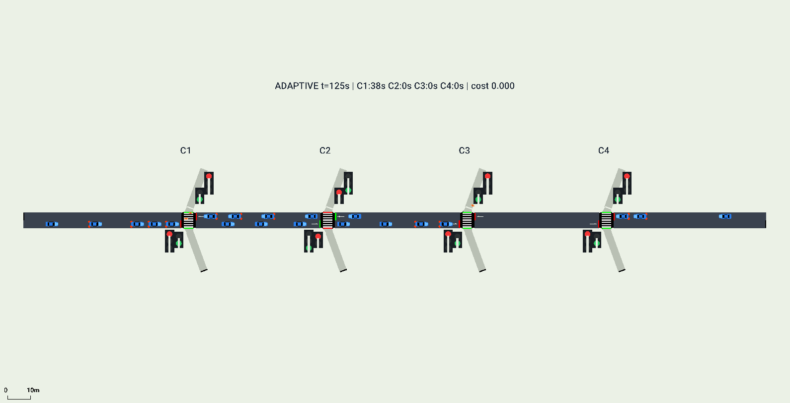

# SUMO 교통신호 강화학습 프로젝트

차량 중심 기본 실험에서 차량·보행자 공동 제어 실험으로 확장한 코드와 실행 기록이다.

**[팀원용 상세 실험 비교 설명서](docs/EXPERIMENT_COMPARISON_KO.md)** — 어떤 논문을 참고했고, 무엇을 구현했으며, 추가 아이디어와 실제 결과가 무엇인지 설명한다.

| 실험 | 목표 | 브랜치 | 실행·설명 |
|---|---|---|---|
| Corridor2-DQN | 두 사거리의 차량 대기 최소화 | [experiment/corridor2-dqn](https://github.com/yoonhb7/RL/tree/experiment/corridor2-dqn) | [기존 안내](docs/CORRIDOR2_README_KO.md), 최상위 `START_SIMULATION.cmd` |
| PedLink-DQN | 네 횡단보도의 보행자 우선·대기 연동 전환 비용 | [experiment/pedlink-dqn](https://github.com/yoonhb7/RL/tree/experiment/pedlink-dqn) | [현재 실험](experiments/pedlink-dqn/README.md), 그 폴더의 `START_SIMULATION.cmd` |

[논문 PDF·서지·라이선스](papers/README.md)를 함께 제공한다. 모델과 결과는 소규모 탐색 실험이며, 원 PPO 논문의 완전 재현이나 DQN의 일반적 우수성을 입증한 결과는 아니다. PedLink-DQN은 이 프로젝트의 이름이다.

별도 PC 설치와 재학습은 [PedLink-DQN 안내](experiments/pedlink-dqn/README.md)를 따른다. 두 모델은 입력·행동 공간이 달라 교환할 수 없다. 새 실험 결과는 `results/local/` 또는 현재 실험의 자동 생성된 새 폴더에 저장한다.
