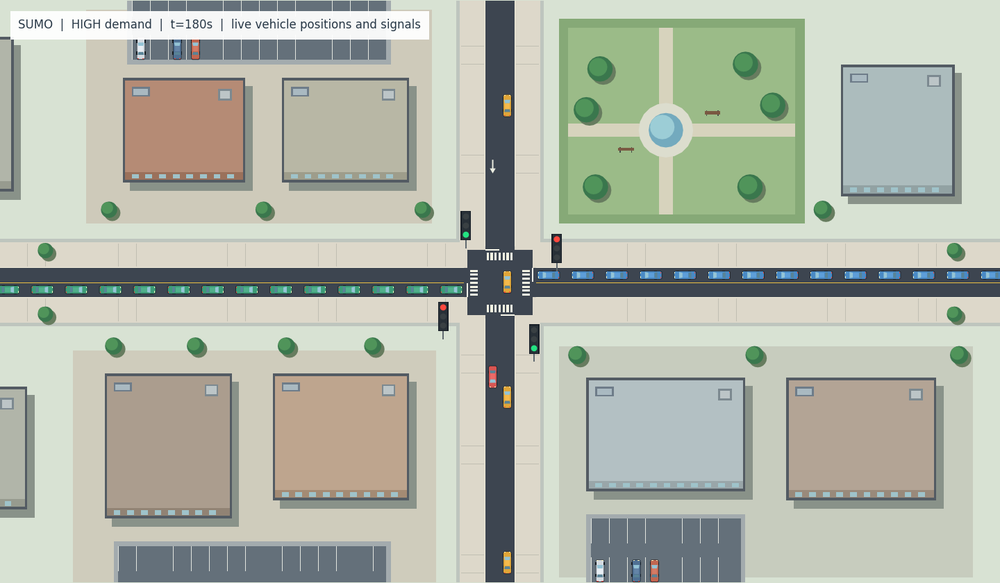

# RL1114 · 단일 교차로 DQN 보상·혼잡도 비교

현재 연구는 **SUMO 단일 교차로·단일 에이전트에서 DQN / Double DQN / Dueling DQN을 보상 함수와 저·중·고 교통량별로 비교**하는 프로젝트다. 이 브랜치는 2026-11-14 환경·코드·파일럿 결과와 도시형 SUMO 화면을 정리한 버전이다.

기준 논문은 **Pálos & Huszák, SoftCOM 2020, _Comparison of Q-Learning based Traffic Light Control Methods and Objective Functions_**다. [논문 DOI](https://doi.org/10.23919/SoftCOM50211.2020.9238290), [원문과 구현의 차이·상태/행동/보상](experiments/single-intersection-dqn-benchmark/METHOD_AND_REWARDS_KO.md)을 함께 읽는다. 저자 코드의 완전 재현이라고 주장하지 않으며 구현상 변경을 문서화했다.

## 현재 환경과 비교 조건

| 항목 | 구현 |
|---|---|
| 환경 | 가상 사거리 1개, 차량 전용, 단일 에이전트 |
| 모델 | DQN / Double DQN / Dueling DQN, 선택적 Dueling Double DQN |
| 관측·행동 | 입력 13개, 현재 현시 유지 또는 전환, 황색 3초 |
| 보상 | WTMin / ASMax / TTMin / CTMax / WCTMax / TMQMax |
| 요청 수요 | 저 450 / 중 1,500 / 고 3,000 veh/h, 네 방향 합계 |
| 공정한 비교 | 공통 도로·수요 생성·학습 설정, 독립 학습 시드와 별도 평가 수요 시드 |
| 본 실험 계획 | 3모델 × 6보상 × 3교통량 × 3학습시드 = 162학습, 810평가 |

**본 실험 162모델은 아직 실행하지 않았다.** 현재 포함된 것은 WTMin 보상으로 9모델을 각 6에피소드 학습한 짧은 파일럿, 정책 27회+기준선 18회의 총 45평가다. 보상 6종은 별도 소규모 실행으로 확인했다. 중·고교통량 정책은 충분히 학습되지 않았으며 알고리즘의 우열을 결론 내릴 수 없다.

## 바로 보기

1. [전체 설치·학습·평가 안내](experiments/single-intersection-dqn-benchmark/README.md)를 따라 Python과 SUMO를 준비한다.
2. 저장소 최상위 **`START_SIMULATION.cmd`** 또는 **`START_VIEW.cmd`**를 실행한다.
3. **1=LOW, 2=MEDIUM, 3=HIGH**를 선택하면 포함된 Double DQN 파일럿 모델로 SUMO GUI가 실행된다. 시연 버튼은 재학습하지 않는다.
4. **`SHOW_RESULTS.cmd`**는 포함된 파일럿 보고서를 연다. **`START_TRAINING.cmd`**는 새 경로 `results/pilot-v3`에 짧은 학습·평가를 실행한다.

Python 명령과 가상환경은 현재 실험 폴더를 기준으로 실행한다. 루트의 기존 `run.py` / `RUN_HERE.ps1` / `TRAIN_TEAM_EXPERIMENT.cmd`는 과거 실험용이므로 현재 연구에는 아래 경로를 사용한다.

```powershell
cd experiments/single-intersection-dqn-benchmark
python -m venv .venv
.venv/Scripts/python -m pip install -r requirements.txt
.venv/Scripts/python start.py doctor
.venv/Scripts/python start.py build
.venv/Scripts/python start.py --config configs/pilot.json view --model results/demo-models/medium/model.pt --levels medium --seeds 1001 --out results/my-view
```

SUMO/TraCI/sumolib는 1.28.0을 기준으로 한다. Linux 서버는 `.venv/bin/python`을 사용하며 학습에 GUI는 필요 없다. RTX 서버의 PyTorch/CUDA는 해당 장치 지원을 확인해서 구성하고 실제 장치를 결과에 기록한다.

## 도시형 시뮬레이션 화면

실제 차량을 따라 움직이는 차체·창문·바퀴, 실제 현시와 연동한 큰 3색 신호등, 건물·보도·주차장·공원과 도로 표시를 추가했다. 장식 유무에 대해 13개 교통 결과가 동일했고 차량 도형과 실제 위치, 네 신호 상태의 일치를 확인했다. 횡단보도는 도색이며 보행자 제어를 추가한 환경은 아니다.

아래는 **실제 SUMO 차량 좌표·신호를 사용한 벡터 미리보기**이며 네이티브 GUI 픽셀 캡처는 아니다. [화면 구현·검증 기록](experiments/single-intersection-dqn-benchmark/CITY_VIEW_KO.md)



## 팀 공유 자료

- [공통 환경·실행 명세](experiments/single-intersection-dqn-benchmark/README.md)
- [논문·모델·상태·행동·보상 정의](experiments/single-intersection-dqn-benchmark/METHOD_AND_REWARDS_KO.md)
- [세 명의 분담·학습·평가·결과 합치기](experiments/single-intersection-dqn-benchmark/TEAM_HANDOFF_KO.md)
- [실제 검증·파일럿 결과와 한계](experiments/single-intersection-dqn-benchmark/VERIFIED_RUNS_KO.md)
- [파일럿 집계 CSV](experiments/single-intersection-dqn-benchmark/results/pilot-report/summary.csv)
- [파일럿 그래프](experiments/single-intersection-dqn-benchmark/results/pilot-report/comparison.png)
- [Windows 더블클릭·DLL 문제 수정](experiments/single-intersection-dqn-benchmark/STARTUP_FIX_KO.md)

완료된 과거 파일럿의 모델·요약·검증 증거를 포함하며 모든 에피소드 원본·설치된 의존성·논문 PDF는 포함하지 않는다. 옛 파일럿 결과의 코드 해시와 현재 표시 코드의 해시는 구분해서 보존했다. 현재 코드의 작업표도 포함한다. [배포 파일 해시](experiments/single-intersection-dqn-benchmark/RELEASE_MANIFEST.json)

## 이전 실험

다중 교차로·보행자 실험은 이전 설계 기록으로 남겼다. 현재 단일 교차로 결과와 섞지 않는다. [이전 프로젝트 안내](docs/PROJECT_STATUS_BEFORE_RL1114.md)

| 브랜치 | 내용 |
|---|---|
| [RL1114](https://github.com/yoonhb7/RL/tree/RL1114) | 현재: 단일 교차로 DQN·보상·저중고 수요 비교 |
| [experiment/corridor2-dqn](https://github.com/yoonhb7/RL/tree/experiment/corridor2-dqn) | 과거: 두 사거리 차량 전용 DQN |
| [experiment/pedlink-dqn](https://github.com/yoonhb7/RL/tree/experiment/pedlink-dqn) | 과거: 네 횡단보도 PedLink-DQN |
| [experiment/pedlink-corridor2-dqn](https://github.com/yoonhb7/RL/tree/experiment/pedlink-corridor2-dqn) | 과거: 두 사거리 차량·보행자 중앙 DQN |
