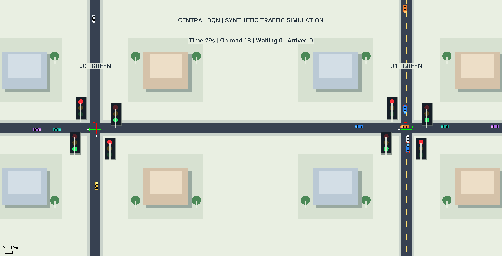

# SUMO 중앙집중형 DQN 교통신호 제어

가상 사거리 1개와 연속 교차로 2·3개를 SUMO에 만들고, **하나의 DQN 에이전트**가 전체 교차로의 신호를 제어하는 프로젝트입니다. 같은 차량 출발시각·경로에서 고정신호, 대기행렬 규칙, 학습한 DQN의 대기시간을 비교합니다.



**현재 도로와 교통량은 직접 설정한 합성 실험입니다.** 직진 차량만 다루며 실제 세종대 도로·교통량·현재 운영 신호를 재현한 결과는 아닙니다.

## 먼저 읽을 문서

- **[설치부터 SUMO 재생·학습·평가까지](docs/SUMO_SIMULATION_GUIDE.md)**
- **[GitHub에 무엇을 올렸고, 앞으로 어떻게 푸시하는가](docs/GITHUB_PUSH_GUIDE.md)**
- [현재 실험의 상태·행동·보상과 DQN 설명](docs/rl_experiment_explained.md)
- [논문 12편 검토 및 구현 범위](docs/paper_review.md)
- [평가 조건과 지표 정의](docs/experiment.md)
- [실제 도로로 이식하는 방법](docs/real_road.md)

## 빠른 시작: Windows PowerShell

Python 3.12 64비트와 Git을 설치한 환경을 기준으로 합니다. 명령은 저장소 최상위 폴더에서 실행하세요.

```powershell
git clone https://github.com/yoonhb7/RL.git
cd RL
py -3.12 -m venv .venv
.\.venv\Scripts\python.exe -m pip install -r requirements-verified.txt
.\.venv\Scripts\python.exe run.py doctor
.\.venv\Scripts\python.exe -c "import torch; print(torch.__version__)"
```

이어서 **100회 학습한 두 교차로 DQN**을 화면으로 재생합니다.

```powershell
.\.venv\Scripts\python.exe run.py view --scenario sumo/corridor2 --model models/corridor2-100ep/model.pt --controllers dqn --seeds 1001 --out results/local/corridor2-demo --delay 1000
```

SUMO GUI가 시작되지 않으면 공식 Windows SUMO 설치의 `SUMO_HOME` 또는 `SUMO_GUI_BINARY`를 지정하세요. 자세한 예시는 [실행 안내서](docs/SUMO_SIMULATION_GUIDE.md)에 있습니다. 기존 작업 PC는 준비된 환경을 이용해 다음 명령으로도 실행할 수 있습니다.

```powershell
powershell -ExecutionPolicy Bypass -File .\RUN_HERE.ps1 -Mode View -Scenario corridor2 -Controller dqn -ModelPath models/corridor2-100ep/model.pt -Delay 1000
```

## 비교 실험

```powershell
.\.venv\Scripts\python.exe run.py evaluate --scenario sumo/corridor2 --model models/corridor2-100ep/model.pt --controllers fixed queue dqn --seeds 1001 1002 1003 1004 1005 --out results/local/corridor2-evaluation-100
Invoke-Item .\results\local\corridor2-evaluation-100\comparison.png
```

같은 수요 5개에 세 방법을 적용하므로 15회 실행합니다. `Evaluate`는 화면 없는 SUMO로 실행하고, `View`는 학습된 모델의 움직임을 보여줍니다. `Train`에서만 신경망을 업데이트합니다.

## 무엇을 구현했는가

| 구성 | 구현 |
|---|---|
| 도로 | 1·2·3개 교차로 자동 생성, 방향별 1차로, 직진 경로 |
| 중앙 에이전트 | 모든 교차로의 관측을 하나의 신경망에 입력 |
| 관측 | 진입 차로별 차량·정지 차량 수, 현시, 진행 단계·경과시간, 에피소드 시간 |
| 행동 | 교차로별 유지/다음 현시; 공동 행동 2·4·8종 |
| 시간 | SUMO 1초 단위 진행, 5초마다 공동 의사결정 |
| 제약 | 녹색 최소 10초·최대 60초, 황색 3초, 전적색 2초 |
| 보상 | 모든 비내부 차로의 정지 차량·초 합의 음수 / 100 |
| DQN | PyTorch MLP 128-128, 경험 재생, 타깃 네트워크, epsilon-greedy, Huber loss |
| 행동 마스크 | 탐험·추론·다음 상태 Bellman target에 적용 |
| 비교 방법 | 녹색 30초 고정신호, 단순 대기행렬 규칙, DQN; Double DQN 선택 구현 |
| 평가 | 동일 수요 해시, 미완료·미출발 차량 집계, CSV·그래프·TripInfo·신호 trace |
| GUI | 실제 신호 상태와 연동한 3색 신호등, 차량·차선·건물·상태 표시 |

화면의 건물과 확대 신호등은 시각적 설명용입니다. DQN은 화면 픽셀이 아닌 SUMO에서 읽은 숫자를 관측하며, 차량의 경로나 도로 구조를 변경하지 않습니다.

## 포함한 학습 모델과 결과

| 모델 | 위치 | 학습 횟수 |
|---|---|---:|
| 단일 사거리 DQN | `results/verified/toy-train/model.pt` | 20 |
| 두 교차로 초기 DQN | `results/verified/corridor2-train/model.pt` | 20 |
| 세 교차로 DQN | `results/verified/corridor3-train/model.pt` | 20 |
| 두 교차로 추가 학습 DQN | `models/corridor2-100ep/model.pt` | 100 |

두 교차로에서 학습 수요 시드 0~99로 100회 학습하고 평가 수요 시드 1001~1005로 실행한 결과입니다. 평균 ± 평가 시드 간 표본 표준편차이며 단위는 초/차량입니다.

| 방법 | 평균 대기시간 |
|---|---:|
| 고정신호 | 27.24 ± 0.58 |
| 대기행렬 규칙 | 15.26 ± 1.89 |
| DQN 100회 모델 | 12.02 ± 1.36 |

이 평가에서 방법별 완료 차량 수는 같고 미완료·미출발 차량은 0입니다. 원시 집계 요약은 [100회 모델 평가 폴더](reports/corridor2-100ep)에 있습니다. 초기 20회 모델의 DQN 대기는 15.81초였으며, [초기 검증 기록](docs/verification.md)과 구분합니다. 독립 학습 실행은 모델당 한 번이며, 합성 수요에서의 이 결과를 실제 도로 성능이나 DQN의 일반적 우월성으로 해석하지 않습니다.

## 저장소 구조

```text
configs/                 합성 실험 설정
sumo/                    네트워크, 현시, manifest, GUI용 수요 예시
src/traffic_rl/          환경, 신호 제약, DQN, SUMO 연결, GUI, 평가
tests/                   단위·SUMO 통합 테스트
models/corridor2-100ep/   100회 모델과 학습 기록
reports/corridor2-100ep/  100회 모델 평가 요약
results/verified/        초기 20회 모델과 평가 요약
docs/                    실행·업로드·실험 설명과 그림
data/templates/          실제 도로 조사표
scripts/                 저장된 trace 감사 도구
```

Python·SUMO 실행파일과 `.venv`, 작업용 런타임, 반복 실험의 대용량 raw 로그는 올리지 않았습니다. 패키지는 requirements로 설치하고 수요와 실행 로그는 코드로 생성합니다. 제공한 `model.pt`는 추론 가중치이며 optimizer·replay까지 복구하는 학습 재개 파일은 아닙니다.

게시 직전 코드 복제본에서 **18개 테스트 통과와 100회 모델의 실제 SUMO 재실행**을 확인했습니다. [검증 기록](reports/validation/README.md)을 참고하세요. `.gitattributes`는 체크포인트의 네트워크 해시가 달라지지 않도록 XML 원본 바이트를 보존합니다.
