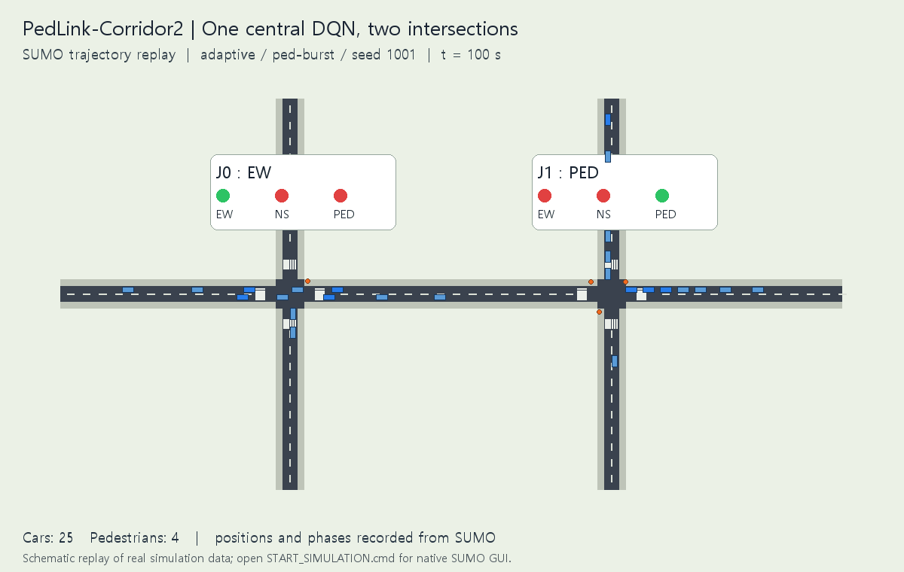

# SUMO 중앙 DQN 교통신호 프로젝트

**현재 실험: 가상 연속 사거리 2개를 하나의 DQN으로 제어하는 PedLink-Corridor2.** 실제 세종대 앞 도로 대신 합성 도로를 사용한다. 차량·보행자 대기를 함께 다루고 보행자 우선 규칙과 대기 연동 전환 비용을 비교한다.

**[현재 실험 설계·결과·실행 안내](../experiments/pedlink-corridor2-dqn/README.md)** · [팀 결정 기록](../docs/TEAM_SCOPE_2026-11-12.md) · [참고 논문 PDF·라이선스](../papers/README.md)

교차로가 두 개여도 에이전트는 하나다. 상태 52개를 중앙 DQN에 입력하고 두 사거리의 동서 차량·남북 차량·보행 공동 요청 9개 중 하나를 고른다.

| 실험 | 역할 | 브랜치 |
|---|---|---|
| **PedLink-Corridor2** | **현재: 사거리 2개, 차량·보행자, 단일 중앙 DQN** | [experiment/pedlink-corridor2-dqn](https://github.com/yoonhb7/RL/tree/experiment/pedlink-corridor2-dqn) |
| Corridor2-DQN | 보존: 사거리 2개의 차량 전용 기본 실험 | [experiment/corridor2-dqn](https://github.com/yoonhb7/RL/tree/experiment/corridor2-dqn) |
| PedLink-DQN | 보존: 직선 도로의 횡단보도 4곳 탐색 단계 | [experiment/pedlink-dqn](https://github.com/yoonhb7/RL/tree/experiment/pedlink-dqn) |

현재 세 모델을 각각 30회 새로 학습하고 고정 신호·대기열 규칙까지 45회 평가했다. 모든 차량·보행자 통행 완료, 잔여·미진입 0, 충돌·teleport 0이었다. 아직 한 번의 독립 초기화이며 추가 반복과 동일 환경 PPO 비교가 필요하다.

## 실행

처음에는 [현재 실험 안내](../experiments/pedlink-corridor2-dqn/README.md)의 Python·SUMO 설치를 따른다. 준비되면 최상위 **`START_SIMULATION.cmd`**가 현재 두 사거리의 실제 SUMO GUI를 연다. **`TRAIN_TEAM_EXPERIMENT.cmd`**는 새 학습·평가·시연을 실행한다.

이전 차량 전용 기본 실험은 **`START_BASELINE_SIMULATION.cmd`**로 재생한다. 최상위 `run.py`와 `RUN_HERE.ps1`는 기존 차량 전용 CLI로 유지하며, 현재 연구 CLI는 `experiments/pedlink-corridor2-dqn/run.py`다.

위 GIF는 SUMO 위치·신호 기록을 재생한 도식이며 native GUI 캡처는 아니다. native GUI 실행 결과와 headless 결과는 별도로 일치 검증했다. [이전 단계 상세 비교](../docs/EXPERIMENT_COMPARISON_KO.md)는 당시 네 횡단보도 설계 기록으로 보존한다.
