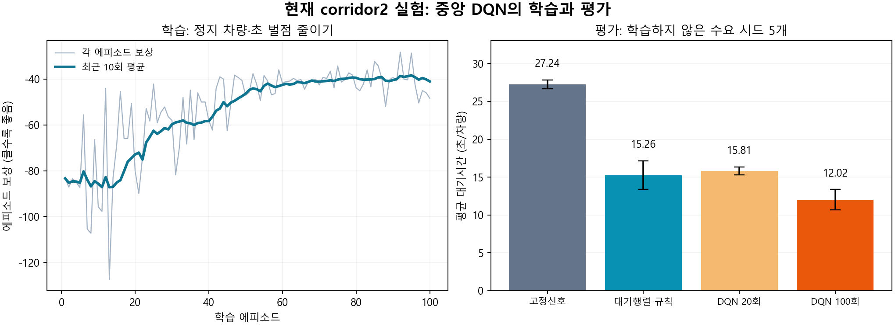

# 현재 실험의 강화학습 정의와 논문 적용 관계

기준: 2026-11-10, `corridor2`, 사용자가 새로 학습한 `results/local/corridor2-train/model.pt`.

현재 과제는 **두 교차로의 교통 상태를 함께 본 중앙 DQN 하나가, 5초마다 각 교차로의 현재 녹색을 유지할지 다음 현시로 넘길지 결정하여 전체 정지 차량·초를 줄이는 것**입니다.

`View`는 이미 학습한 모델의 추론입니다. 관측과 보상은 계산하지만 optimizer를 실행하지 않아 신경망 가중치는 변하지 않습니다. `Train`에서만 경험 저장과 경사 업데이트를 수행합니다. 붙여준 이전 설명의 20회 모델과 현재의 100회 모델을 구분해야 합니다.

## 1. 무엇을 사람이 정했고, 무엇을 에이전트가 배우는가

| 사람이 미리 정한 부분 | DQN이 데이터로 배우는 부분 |
|---|---|
| 가상 도로 형상, 교차로 간 거리, 차로 연결 | 주어진 차량 상태에서 네 공동 행동의 장기 가치 |
| 직진 차량의 출발시각·경로 생성 규칙 | 지금 녹색을 더 줄지, 다음 방향으로 넘길지 |
| 남북/동서 2개 녹색 현시와 고정된 순서 | A와 B에 서로 다른 결정을 언제 줄지 |
| 최소·최대 녹색, 황색·전적색 | 현시 유지/전환 선택을 통한 간접적인 녹색시간 조절 |
| 상태·보상·신경망 구조·학습 설정 | 상태에서 Q값으로 가는 신경망 가중치 |

화면의 건물·확대 차량·신호등 그래픽은 표현용입니다. 학습 입력은 픽셀이 아니라 SUMO에서 읽어 온 숫자입니다. 신호 전환 제약은 학습된 정책 바깥의 안전 상태기가 강제합니다.

## 2. 환경과 실험 질문

```text
       북 ↕                          북 ↕
서 ↔ [A: J0] ↔ 약 400 m 연결 구간 ↔ [B: J1] ↔ 동
       남 ↕                          남 ↕
```

방향별 한 차로, 직진만 허용합니다. 동서 경계 유입은 방향별 평균 600대/시간, 각 교차로 남북 유입은 방향별 평균 250대/시간입니다. 지수분포 도착 간격으로 출발시각을 생성해 명시적 차량 XML에 확정합니다. 같은 평가 시드에서는 세 방법이 같은 차량 목록·경로 파일과 SUMO 시드를 사용합니다.

가로 유입이 세로 유입보다 많도록 설정해 녹색시간을 균등하게 주는 고정신호와 적응형 제어의 차이를 볼 수 있게 했습니다. 차량이 A를 통과하면 B의 도착 흐름에도 영향을 주므로 중앙 관측이 의미를 가질 수 있습니다. 이 구조만으로 실제 신호 연동을 학습했다는 것이 증명되지는 않습니다.

현재 검증하는 질문은 “같은 수요와 신호 제약에서 중앙 DQN이 실험용 고정신호 및 단순 대기행렬 규칙보다 정지 대기를 줄이는가?”입니다. 실제 세종대 운영 신호 대비 개선이나 중앙 제어의 우월성 자체를 검증한 단계는 아닙니다.

## 3. 상태 S: 29개 숫자

각 교차로의 네 진입 차로에서 정지 차량 수와 전체 차량 수를 읽습니다. 차로 용량은 `max(1, 차로 길이 / 7.5m)`로 근사하며, 두 차량 수를 이 값으로 나눕니다. 모든 입력은 최종적으로 [0,1] 범위로 잘라 넣습니다.

| 항목 | 교차로당 차원 |
|---|---:|
| 네 진입 차로의 정지 차량 수 | 4 |
| 네 진입 차로의 전체 차량 수 | 4 |
| 기준 녹색 현시 one-hot: 남북 / 동서 | 2 |
| 진행 단계 one-hot: 녹색 / 황색 / 전적색 | 3 |
| 현재 단계 경과시간 / 해당 단계의 기준 최대시간 | 1 |
| 교차로당 합계 | 14 |

`s = [에피소드 경과시간/900, A의 14개 값, B의 14개 값]`이므로 총 29차원입니다. 황색·전적색에서도 직전 기준 녹색 현시와 진행 단계를 함께 관측합니다. A←B와 A→B 연결 구간은 각각 A/B의 진입 차로에 포함되어 차량 수와 대기열을 관측합니다.

이는 SUMO의 모든 차량 위치·속도를 포함하는 완전한 물리 상태가 아니라 요약 관측입니다. 따라서 완전한 Markov 성질이 보장된다고 주장하지 않습니다.

## 4. 행동 A: 한 에이전트가 고르는 네 공동 행동

| 행동 번호 | A | B |
|---:|---|---|
| 0 | 유지 | 유지 |
| 1 | 다음 현시로 전환 | 유지 |
| 2 | 유지 | 다음 현시로 전환 |
| 3 | 다음 현시로 전환 | 다음 현시로 전환 |

코드에서는 A가 최하위 비트입니다. “전환”은 임의의 방향을 새로 생성하는 것이 아니라, 남북 녹색과 동서 녹색을 정해진 순서로 바꾸는 요청입니다. 녹색시간을 37초처럼 직접 출력하지 않습니다. 유지 선택을 반복하거나 전환을 요청한 결과로 녹색시간이 정해집니다.

안전 제약은 최소 녹색 10초, 최대 녹색 60초, 황색 3초, 전적색 2초입니다. 최소 녹색 전에는 전환을 마스킹하고, 최대 녹색에서는 유지를 마스킹합니다. 황색·전적색 동안은 유지 코드만 허용합니다. 최대시간은 의사결정 사이에도 1초 단위로 강제합니다.

이 마스크는 무작위 탐험, 최종 행동 선택, Bellman target의 다음 상태 최대값 계산에 모두 적용합니다.

## 5. 보상 R: 전체 정지 차량·초의 음수

```text
r_t = -(다음 5초 동안 모든 비내부 차로의 정지 차량 수를 매초 더한 값) / 100
```

20대가 5초 내내 정지하면 `r=-1`, 10대면 `r=-0.5`입니다. DQN은 할인된 누적 보상을 최대화하므로 현재뿐 아니라 이후의 정지 대기까지 줄이도록 학습합니다. 황색과 전적색 동안의 정지도 보상에 포함되어 전환의 손실이 간접적으로 반영됩니다. 별도 신호변경 패널티는 없습니다.

이 목적은 평균 대기시간과 관련되지만 같은 지표는 아닙니다. 보상은 비내부 차로의 총 정지 차량·초이며, 경계 바깥 미출발 대기와 교차로 내부 차로는 제외됩니다. 평가에서는 `tripinfo` 대기시간, 미완료·미출발, 경계 대기를 따로 확인합니다.

## 6. DQN이 실제 학습되는 방식

```text
29차원 관측
 → Online Q-network: 29 → 128 ReLU → 128 ReLU → 4
 → 합법 행동 중 하나 선택
 → 안전 상태기
 → SUMO 5초 진행
 → 보상·다음 관측·다음 합법 행동 집합
 → 경험 재생 버퍼에 저장
```

1. epsilon 확률로 합법 행동을 무작위 선택하고, 나머지는 Q값이 가장 큰 합법 행동을 선택합니다.
2. `(s, a, r, s_next, terminal, next_mask)`를 리플레이 버퍼에 저장합니다.
3. 256개 경험을 모은 뒤, 의사결정 4회마다 무작위 64개를 뽑아 학습합니다.
4. target은 `y = r + 0.99 * (1-terminal) * max_valid Q_target(s_next, a_next)`입니다.
5. 현재 `Q_online(s,a)`가 이 target에 가까워지도록 Huber loss와 Adam으로 업데이트합니다.
6. 경사 업데이트 250회마다 Online 가중치를 Target에 복사합니다.

Online과 Target이라는 두 신경망이 있어도 정책 에이전트는 하나입니다. Target은 학습 목표의 급격한 변동을 줄이기 위한 복사본입니다. 현재 100회 모델은 기본 DQN입니다. `--double`은 선택 기능으로 구현되어 있지만 이번 결과는 Double DQN 결과가 아닙니다.

| 설정 | 실제 100회 학습값 |
|---|---:|
| 에피소드 길이 | 900 SUMO초 |
| 수요 생성 구간 | 첫 600초 |
| 의사결정 간격 | 5초 |
| 에피소드당 의사결정 | 180회 |
| 전체 의사결정 | 18,000회 |
| 경사 업데이트 | 4,437회 |
| 리플레이 용량 / 배치 | 50,000 / 64 |
| 학습률 / 할인율 | 0.001 / 0.99 |
| epsilon | 1.0 → 0.05, 예정된 의사결정의 처음 70% 동안 감소 |
| 학습 수요 시드 | 0~99 |
| 독립 신경망 초기화 반복 | 1회 |

이 수치들은 프로젝트의 초기 실행 설정입니다. 첨부 논문 하나의 하이퍼파라미터를 전부 그대로 복제한 값이 아닙니다.

## 7. 실제 모델의 55초 시점 판단

평가 시드 1001을 동일하게 재실행해 추출했습니다. 원시 관측과 첫 150초의 판단은 `decision_example.json`에 있습니다.

- A: 동서 녹색 10초 경과, 남북 정지 차량 2대, 동서 정지 차량 0대.
- B: 동서 녹색 20초 경과, 남북 정지 차량 2대, 동서 정지 차량 0대.
- 네 공동 행동이 모두 합법입니다.

| 행동 | Q값 추정 |
|---|---:|
| 0: A 유지 / B 유지 | **-4.2322** |
| 1: A 전환 / B 유지 | -4.5443 |
| 2: A 유지 / B 전환 | -4.3794 |
| 3: A 전환 / B 전환 | -4.4114 |

이 모델은 가장 큰 값인 행동 0을 선택했습니다. 다음 5초의 실제 정지 차량·초는 23, 즉 보상은 -0.23이었습니다. Q=-4.2322는 현재 대기시간이 4.2322초라는 의미가 아니라, 할인된 장기 보상의 신경망 추정값입니다.

같은 순간의 대기행렬 규칙은 남북 정지 차량이 더 많으므로 두 교차로의 전환을 요청합니다. DQN이 어떤 상태 정보를 얼마나 활용해 유지 선택을 했는지는 이 Q값 하나만으로 인과적으로 설명할 수 없습니다. 전체 차량 수와 연결 구간 관측을 포함한 학습 정책의 선택이라는 사실까지 확인한 것입니다.

## 8. 어떤 논문을 어떤 수준으로 반영했는가

| 논문 | 반영한 내용 | 현재와 원문의 차이 |
|---|---|---|
| IATSS Research 2025, Adaptive traffic signal control... | SUMO/TraCI, 차로 밀도·정지 대기열·현시를 쓰는 State 3, DQN 비교와 녹색시간 제약 | 원문 PDF p.5는 황색 4초. 우리는 3초+전적색 2초를 설계. 다목적 안전·CO₂ 보상을 그대로 복제하지 않음 |
| 국내 차량·보행자 다중 교차로 논문 | 두 교차로 상태와 연결 구간을 중앙 에이전트가 함께 관측하고 공동 행동 선택 | 원문 PDF p.4는 4방향×4방향=16행동, 보행자·연결 구간 혼잡·변경 패널티 포함. 우리는 유지/전환×유지/전환=4행동, 차량 정지만 보상 |
| Single-Agent Urban Corridors 2026 | 단일 에이전트로 연속 교차로를 관리한다는 문제 정의, 대기행렬 중심 설계 | 원문 PDF p.7은 교차로 하나를 선택해 Split을 -Δ/0/+Δ 조정하는 3M 행동. 현재는 공동 유지/전환 2^M 행동 |
| CenLight 2023 | 전체 상태와 공동 행동으로 제어 문제를 정의하고 행동공간 크기를 고려 | 원문 PDF p.5는 LSTM·actor-critic로 행동을 순차 분해. 이번에는 작은 4행동 DQN을 직접 계산 |
| MGMQ 2024 | 불가능한 행동을 배제하고 target에도 일관된 마스크를 쓰는 아이디어 | 원문 PDF pp.12~13의 주된 마스크는 사거리/T자 교차로의 가능한 현시 차이. 이번에는 최소·최대 녹색과 전환 단계의 시간 제약 마스크로 적용. 그래프·MARL 구조는 도입하지 않음 |

현재 구현은 여러 문헌의 요소를 조합해 작성한 독립적인 최소 베이스라인입니다. 논문 하나의 전체 알고리즘이나 수치 성능을 재현했다고 부르지 않습니다. HyLight의 Offset/Split, SVD-CNN, H-DQN의 현시·시간 혼합 제어, 보행자·긴급차·보안 등은 현재 제어기에 포함하지 않았습니다.

핵심 원문은 첨부 PDF를 기준으로 검토했으며, 식별자는 다음과 같습니다.

- IATSS: https://doi.org/10.1016/j.iatssr.2025.10.004
- 국내 차량·보행자: https://doi.org/10.13067/JKIECS.2026.21.2.807
- Single-Agent Corridors: https://doi.org/10.1155/atr/5134018
- CenLight: https://doi.org/10.1049/itr2.12354
- MGMQ: https://doi.org/10.1016/j.trc.2024.104582

전체 12편 검토는 `paper_review.md`에 있습니다.

## 9. 비교 실험과 실제 결과

평가에서는 탐험을 끄고 학습 가중치를 고정합니다. 평가 수요 시드 1001~1005마다 고정신호, 대기행렬 규칙, DQN을 실행하여 총 15회 비교합니다. warm-up은 0초이고 모든 방법이 900초까지 진행합니다.

- 고정신호: 남북/동서에 각각 녹색 30초, 황색 3초, 전적색 2초. 한 주기 70초. 수요에 최적화한 고정신호는 아닙니다.
- 대기행렬 규칙: 다음 녹색 방향에 정지한 차가 현재 방향보다 많으면 전환 요청. 학습 없음. SUMO actuated와 다른 방법입니다.
- DQN: 전체 29차원 상태로 네 공동 행동의 장기 보상을 추정. 세 방법 모두 같은 안전 시간 제약을 사용합니다.

| 방법 | 평균 대기시간 ± 평가 시드 표본 표준편차 |
|---|---:|
| 고정신호 | 27.24 ± 0.58초/차량 |
| 대기행렬 규칙 | 15.26 ± 1.89초/차량 |
| DQN 20회 학습 모델 | 15.81 ± 0.53초/차량 |
| DQN 100회 학습 모델 | 12.02 ± 1.36초/차량 |

100회 모델은 고정신호 평균 대비 약 55.9%, 규칙 평균 대비 약 21.2% 낮았습니다. 감소율은 각각의 시드 평균을 먼저 구한 뒤 두 평균으로 계산했습니다. 모든 평가에서 예정 차량을 전부 처리했고 미완료·미출발은 0입니다. 완료 차량 수는 평가 시드 평균 363.8대로 방법 간 같습니다.



학습 곡선은 탐험 정책의 결과이고 매 에피소드 수요 시드가 바뀝니다. 곡선 하나만으로 수렴이나 통계적 우월성을 확정할 수 없습니다. 20회와 100회는 각각 처음부터 학습한 모델이고, 총 학습 예산에 따라 epsilon 감소 기간도 달라지므로 학습 횟수 하나만 분리한 엄밀한 ablation은 아닙니다.

## 10. 현재 입증한 것과 남아 있는 것

현재는 “이 합성 수요와 이 초기화에서 학습한 100회 DQN이 다섯 평가 수요에서 두 기준선보다 낮은 대기를 보였다”까지 확인했습니다.

아직 입증하지 않은 것은 다음과 같습니다.

1. **중앙 관측의 이점:** 연결 구간 관측을 제거해 다시 학습한 모델과 비교해야 합니다.
2. **연동 전략의 학습:** 신호 Offset·연결 구간 도착 시각·연속 통과 비율 등을 분석해야 합니다. 공동 행동을 출력한다는 사실만으로 녹색 연동을 학습했다고 할 수 없습니다.
3. **독립 학습의 재현성:** 수요를 달리한 100에피소드는 서로 다른 신경망 초기화 100회와 다릅니다. 여러 학습 초기화로 반복해야 합니다.
4. **수요·도로 일반화:** 교통량 ±20%, 다른 방향 비율·회전교통, 다른 시간대로 평가해야 합니다.
5. **강한 기준선:** 수요에 맞춘 고정시간과 실제 검지기 기반 actuated를 추가해야 합니다.
6. **실제 도로 성능:** 세종대 현장 차로·신호·교통량 보정 후에 검증해야 합니다.

## 코드와 결과의 대응

| 확인할 내용 | 파일 / 함수 |
|---|---|
| 29차원 상태 | `src/traffic_rl/env.py`, `_observe()` |
| 5초 실행과 보상 | `src/traffic_rl/env.py`, `step()` |
| 네 행동과 안전 마스크 | `src/traffic_rl/signals.py` |
| Q-network, replay, target 갱신 | `src/traffic_rl/dqn.py` |
| 현재 학습 설정 | `results/local/corridor2-train/training_config.json` |
| 현재 성능표 | `results/local/corridor2-evaluation-100/summary.csv` |
| 실제 55초 판단 원시 값 | `docs/decision_example.json` |
