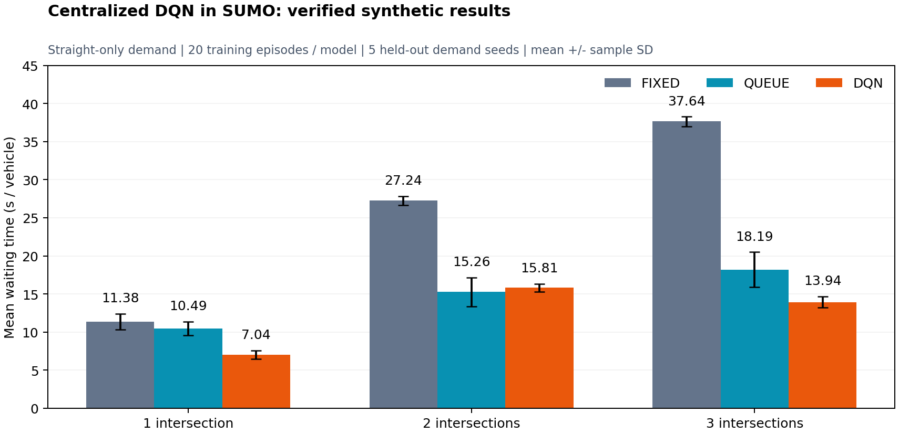

# 이번 구현의 실행 검증 결과

검증일: 2026-11-10 (Asia/Seoul). Windows x86-64, Python 3.12.14, SUMO/TraCI 1.28.0, Gymnasium 1.2.2, PyTorch 2.15.0 CPU, NumPy 2.5.4, Matplotlib 3.10.8. 핵심 버전은 `requirements-verified.txt`에 기록했습니다.

## 실제 실행 결과

네트워크별로 하나의 DQN을 20에피소드 학습했습니다. 학습 수요 시드는 0~19, 평가 수요 시드는 1001~1005입니다. 각 에피소드는 900초, 5초마다 의사결정하며 모델별 총 3,600회 의사결정·837회 경사 업데이트를 수행했습니다. 제어할 교차로가 늘어도 정책은 하나입니다.

아래 값은 **5개 평가 시드의 대기시간 평균 ± 표본 표준편차**(초/차량)입니다. 모든 평가에서 모든 예정 차량이 도착해, 미완료를 포함한 관측 평균과 도착 차량 평균이 일치했습니다.

| 시나리오 | 고정신호 | 대기행렬 규칙 | 중앙 DQN | 고정신호 대비 DQN 감소율 | 완료 차량 수 평균 |
|---|---:|---:|---:|---:|---:|
| 단일 사거리 | 11.38 ± 1.03 | 10.49 ± 0.90 | 7.04 ± 0.56 | 38.1% | 275.6 |
| 연속 교차로 2개 | 27.24 ± 0.58 | 15.26 ± 1.89 | 15.81 ± 0.53 | 42.0% | 363.8 |
| 연속 교차로 3개 | 37.64 ± 0.65 | 18.19 ± 2.31 | 13.94 ± 0.75 | 63.0% | 443.4 |

감소율은 시드별 평균 대기값을 먼저 평균한 뒤, 두 방법의 평균으로 계산했습니다. `paired.csv`의 시드별 감소율 평균과는 조금 다를 수 있습니다. 완료 차량 수는 방법 간 동일하며 수요 시드에 따라 달라집니다.

**2개 교차로에서는 대기행렬 규칙이 DQN보다 약간 좋았습니다.** 20에피소드의 짧은 학습, 단순한 수요, 기준선의 제어 권한 안에서 나온 결과입니다. 3개 교차로와 단일 교차로에서는 이 DQN 모델이 해당 규칙보다 대기를 줄였습니다. 하나의 방법이 모든 경우에 가장 좋다고 결론 내리지 않습니다.

## 검증한 내용

- 17개 단위·통합 테스트 통과: 공동 행동 인코딩, 비대칭 마스크, 최소·최대 녹색, 황색·전적색 정확한 길이, 생성된 도로의 비충돌 녹색, 실제 SUMO 통행과 reset, 동일 수요, 미출발·미완료 집계, DQN/Double DQN의 타깃 마스크, 모델 저장·안전 로드, 최종 linkIndex 추출, native 신호 XML·Offset 보존.
- 45개 평가 실행의 차량 수 보존식과 TripInfo 행 수 일치.
- 모든 평가에서 미완료·미출발 차량 0, 충돌 사건·teleport 0.
- 81,000개 교차로-초 신호 기록에서 전환 순서와 최소·최대 녹색, 황색 3초, 전적색 2초 조건 확인. 종료시점의 마지막 현시는 잘릴 수 있으므로 마지막 부분 구간의 최소 길이는 강제하지 않음.
- 같은 평가 시드에서 세 방법이 동일한 수요 파일 SHA-256을 사용함.
- 세 학습 모델을 최종 도로·관측 스키마로 다시 로드하는 데 성공.
- `RUN_HERE.ps1 -Mode Doctor` 실행 확인. headless SUMO 실험으로 정책을 검증했으며, 사용자가 보는 GUI 재생 화면은 별도 수동 검토하지 않음.

## 자료 위치

- `results/verified/toy-evaluation`, `corridor2-evaluation`, `corridor3-evaluation`: CSV·JSON·신호 trace·TripInfo·비교 그림.
- `results/verified/toy-train`, `corridor2-train`, `corridor3-train`: 학습 로그·학습 곡선·model.pt.
- `results/verified/tests.xml`: 테스트 결과.
- `results/verified/audit.json`: 전체 평가 trace 감사 결과. `python scripts/audit_results.py`로 다시 확인 가능.

## 해석의 한계와 다음 실험

이번 결과는 **직진만 허용한 합성 도로, 한 가지 평균 수요 패턴, 네트워크당 한 번의 학습 실행**입니다. 실제 세종대 도로의 개선율, 다른 논문의 재현 수치, 현장 적용 성능으로 해석할 수 없습니다. 좌·우회전·보행자·실측 Offset·시간대별 교통량 보정은 후속 작업입니다. warm-up은 0초입니다.

논문 수준의 성능 검증에는 독립 학습 초기화 반복, 더 다양한 수요·회전 패턴, 조정된 고정신호와 actuated/강한 규칙 기준선, 실제 데이터 보정, 충분한 학습 예산이 필요합니다. Double DQN은 구현과 타깃 계산 테스트를 포함했지만 이번 성능표는 기본 DQN만 비교했습니다.
