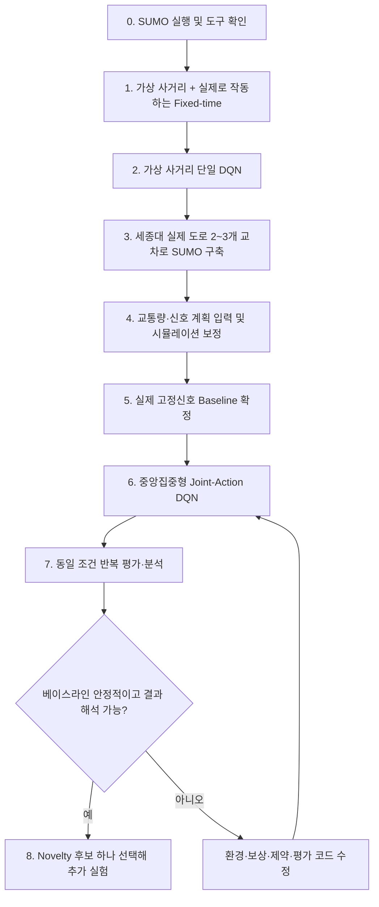

# SUMO 기반 실제 연속 교차로의 중앙집중형 DQN 교통 신호 제어 프로젝트 계획서

> **계획 버전:** v0.1 (2026-11-08)  
> **프로젝트 성격:** 강화학습 수업 프로젝트 → 연구형 프로젝트로 확장 가능  
> **대상:** 세종대학교 인근 연속 교차로 2~3개  
> **핵심 원칙:** **실행 가능한 베이스라인 확보 → 실제 도로 재현 및 검증 → 단일 에이전트 확장 → 공정한 평가 → 필요할 때만 Novelty 추가**

## 현재 실행 방침과 진행 상태 — 2026-11-11

- **현장 방문·직접 교통량 계수·촬영은 하지 않는다.** 아래 v0.1 초안의 현장 조사 항목은 현재 필수 작업에서 제외한다.
- 공개 지도에서 도로 형상을 가져오고 확보하지 못한 차로·수요·신호시간·Offset은 가정값으로 명시한다.
  이 조건에서는 결과를 실제 교통이나 실제 운영 신호를 보정·재현한 성능이라고 주장하지 않는다.
- 단일 가상 교차로의 Fixed-time, Gymnasium DQN과 첫 5,000회 학습·평가 기록은 확보했다.
- 다음 대상은 **화양삼거리–어린이대공원역 교차로**다. OSM 원본을 내려받았고,
  두 교차로 도로 생성은 성공했으며 첫 고정신호 실행은 충돌·텔레포트로 검증 실패했다.
  방향별 분리 신호와 Offset 검사 수정을 준비했고 **수정본은 아직 실행 전**이다.
- 이번 단계의 실행과 완료 조건은 [두 교차로 고정신호 안내](docs/sejong2_fixed.md)를 따른다.
  고정신호 통행·집계를 확인한 뒤 중앙집중형 DQN으로 확장한다.

---

## 0. 가장 먼저 내릴 결정: 어떤 논문부터 따라 할 것인가?

### 0.1 최종 추천

**첫 번째 재현·학습 논문은 Elharoun et al., IATSS Research (2025)**, *Adaptive traffic signal control using deep reinforcement learning: A multi-objective approach for single and multi-intersection scenarios*로 정한다.

- **추천 이유:** SUMO + TraCI를 이용한 **단일 교차로**, **이산 신호 현시 선택**, **DQN**, **Fixed-time·Actuated 비교**를 모두 다룬다. State/Action/Reward가 비교적 단순하여 첫 작동 모델을 만들기 좋다.
- **재현 범위:** 논문 전체 재현이 아니라 **가상 사거리, 2현시, DQN, 단순 교통량, Fixed-time 기준선**만 먼저 재현한다. 논문의 6개 보상, TTC, CO₂, PPO/A2C는 초기에 구현하지 않는다.
- **주의:** 논문에 모든 SUMO 설정 파일과 학습 코드가 재현 가능한 형태로 제공된 것은 아니다. 따라서 **논문 설계를 따라 직접 최소 구현(minimal reproduction)**하며, 수치 결과를 정확히 복제했다고 주장하지 않는다.
- **논문 근거:** 4~6쪽의 실험 설계·상태·행동·보상, 6~7쪽의 학습 설정과 상태별 실험. [DOI](https://doi.org/10.1016/j.iatssr.2025.10.004).

**두 번째 중심 논문은 Li et al., Journal of Advanced Transportation (2026)**, *Single-Agent Reinforcement Learning Model for Adaptive Traffic Signal Control in Urban Corridors*로 정한다.

- **이유:** 하나의 에이전트가 여러 교차로를 관리하는 **중앙집중형 MDP**가 본 프로젝트와 직접적으로 맞는다.
- **가져올 요소:** 전체 도로 구간의 상태를 합쳐 관측하는 방식, 신호시간 배분(Phase Split)이라는 대안적 행동 설계, 대기행렬 기반 보상.
- **차이:** 논문은 한 번에 *교차로 하나*의 Split을 ±2초 조정하여 행동 수를 `3M`으로 제한한다. 우리 프로젝트는 **2~3개 교차로에 대한 결합 행동(Joint Action)**도 비교할 수 있다.
- **논문 근거:** 6~9쪽의 State/Action/Reward와 SUMO 환경. [DOI](https://doi.org/10.1155/atr/5134018).

### 0.2 논문별 '가져올 것'과 '초기에는 가져오지 않을 것'

| 논문 | 지금 가져올 부분 | 확장 시 가져올 부분 | 초기에는 제외할 부분 |
|---|---|---|---|
| **IATSS Research 2025** | **SUMO→TraCI→DQN**, 2현시 단일 사거리, State 3(현시+밀도+대기행렬), 고정신호 및 Actuated 기준선 | Reward별 비교, PPO·A2C, 안전성·CO₂ | TTC/SSM·CO₂ 다목적 최적화부터 시작하는 것 |
| **Single-Agent Urban Corridors 2026** | **중앙집중형 단일 에이전트 정의**, 구간별 대기행렬, 동작 제약 | Split 제어, 한 교차로 순차 조정 `3M` vs 동시 조정 `3^M` | Mesoscopic 환경 및 논문 특유의 대기행렬 추정까지 완전 복제 |
| **CenLight 2023** | **여러 교차로 상태/행동을 하나의 Joint MDP로 표현**하는 개념 | 행동공간이 커질 때 분해 구조 검토 | LSTM·Actor-Critic 전체 재현 (DQN 연구 범위 밖) |
| **HyLight, TR-C 2026** | **한국 실제 도로망 재현 방법**, 교차로별 현시·최소 녹색시간, 회전 교통량·Offset 조사, 실험 시나리오 | Offset·Split 상호작용, 교통량 변화 일반화 | 교차로별 SAC·GAT·GRU 기반 MARL 전체 재현 |
| **MGMQ, TR-C 2024** | **차로별 상태 5종**, Double DQN, 실행 불가능한 신호현시 Action Mask, 신호변경 패널티 | 인접 교차로 정보 및 GNN의 가치 비교 | GAT+GraphSAGE+Bi-GRU의 대규모 MARL 구조 |

**실무 결론:** **논문 1편을 통째로 따라 하는 것이 아니라, IATSS로 학습 파이프라인을 완성한 뒤 나머지 논문의 핵심 아이디어를 단계적으로 추가**한다.

---

## 1. 프로젝트 최종 목표와 연구 질문

### 최종 목표

> 서울 세종대학교 인근 실제 연속 교차로 2~3개의 도로 구조·교통량·고정신호 운영을 SUMO에 재현하고, **하나의 중앙집중형 DQN 에이전트**로 신호를 제어하여 기존 고정시간 신호 대비 평균 대기시간이 얼마나 감소하는지 검증한다.

### 핵심 연구 질문

- **RQ1 (필수):** 같은 교통량과 신호 제약에서 중앙집중형 DQN이 실제 고정신호보다 대기시간을 줄이는가?
- **RQ2 (권장):** 전체 교차로의 정보를 이용하는 것이 제한된 정보만 이용하는 것보다 효과적인가?
- **RQ3 (확장):** 교통량과 회전 비율이 바뀌어도 학습된 정책의 성능이 유지되는가?
- **RQ4 (선택):** DQN → Double DQN, 또는 현시 제어 → Split 제어가 추가 성능 향상을 만드는가?

**중요:** '단일 에이전트로 다중 교차로 제어' 자체는 선행연구가 있으므로 이를 독창적 기여로 주장하지 않는다. 처음에는 **정확히 작동하는 베이스라인**을 목표로 한다.

---

## 2. 전체 실행 로드맵과 완료 기준(Gate)



| 단계 | 산출물 | 다음 단계로 넘어가는 최소 조건 |
|---|---|---|
| **0** 개발 환경 점검 | `sumo --version`, `sumo-gui`, Python/TraCI 실행 기록 | SUMO 실행·Python 연결 성공 |
| **1** 가상 교차로 | `toy.net.xml`, `toy.rou.xml`, `toy.sumocfg`, Fixed-time 실행 결과 | 차량이 적법한 경로로 통과하고 신호 순환 확인 |
| **2** 첫 DQN 베이스라인 | 단일 교차로 DQN + 학습 곡선 + Fixed-time 비교 | 학습/평가 분리, 재현 가능한 1회 학습 성공 |
| **3** 실제 도로망 | `sejong.net.xml`, 교차로/차로/현시 목록 | 2~3개 교차로 구조·연결·회전 방향 확인 |
| **4** 실제 수요/신호 구현 | 교통량 CSV, 회전 비율, 신호시간, 보정 기록 | 실제 관측과 SUMO의 흐름·대기행렬을 비교한 검증표 |
| **5** 현장 고정신호 기준선 | 검증된 Fixed-time 성능표/영상 | 모든 RL 방법과 같은 조건의 비교 기준 확보 |
| **6** 중앙집중형 DQN | `CentralizedTrafficEnv`, 공동 행동 모델 | 하나의 Agent가 모든 교차로를 제어하고 금지 신호 전환이 없음 |
| **7** 최종 실험 | 여러 시드 결과표, 그림, 오류 분석 | 재현 가능한 공정 평가 및 실험 보고서 |
| **8** 선택적 Novelty | Ablation 1개 이상의 추가 실험 | 기본 베이스라인을 유지한 채 차별화 요소 검증 |

---

## 3. Phase A — SUMO 익히기: 가장 작은 베이스라인부터

### A-1. 개발 도구 구성

- **SUMO / sumo-gui:** 도로 생성 및 시각적 디버깅.
- **netedit:** 도로·차로·신호 수정.
- **TraCI:** Python이 SUMO의 정보를 읽고 신호를 제어하는 통신 인터페이스.
- **Gymnasium:** `reset()`, `step()`을 갖는 RL 환경 래퍼.
- **Stable-Baselines3 DQN:** 첫 학습 베이스라인. 필요 시 PyTorch 직접 구현으로 교체.
- **SUMO-RL:** 단일 교차로 예제와 상태·보상·제어 코드의 **참고 구현**으로 활용.

> **주의:** `SUMO-RL`의 `single_agent=True` 예제가 있다고 해서 **교차로 3개를 하나의 Joint Action으로 자동 통합 제어**한다고 간주하면 안 된다. 최종 프로젝트에는 `TraCI + 사용자 정의 Gymnasium.Env`로 명시적인 중앙집중형 제어 환경을 만드는 편이 확실하다.

**Mac 환경 확인용:** 아래는 설치 상태를 확인하는 예시이며, 실행 전에 실제 설치 경로를 확인한다.

```bash
sumo --version
sumo-gui --version
python -c "import traci, gymnasium, stable_baselines3; print('Python RL imports OK')"
```

- macOS에서 Python 패키지 충돌을 피하려면 프로젝트별 가상환경(예: Python 3.11 기반)을 권장한다.
- 학습은 화면 없는 `sumo`, 검증용 시각 확인은 `sumo-gui`를 사용하는 것이 편리하다.
- 나중에 속도가 문제일 때 TraCI에서 libsumo로 이전한다. 먼저 API 기능을 검증한 뒤 성능 최적화를 한다.

### A-2. 가상 교차로 1개 생성

**IATSS 논문 4~6쪽의 단일 사거리와 2현시 설계를 참고.**

- 사거리 1개, 4방향 진입, 진입 방향마다 2차로(초기에는 1차로도 가능).
- 차량 흐름: 직진 중심의 단순 수요로 시작하고 좌/우회전은 다음 실험에서 추가.
- 행동 후보: `남북 녹색`, `동서 녹색`.
- SUMO의 고정신호 프로그램을 만들어 모든 차량이 정상적으로 통과하는지 확인.
- **먼저 DQN 없이 실행**하여 차량이 끼이거나 도로가 막히지 않는지 확인.

```text
      북쪽 차량
         ↓
서쪽 → [교차로] → 동쪽
         ↑
      남쪽 차량

현시 0: 남북 녹색 / 동서 적색
현시 1: 동서 녹색 / 남북 적색
전환: 황색·필요한 전적색을 미리 정의
```

**산출물:** 재생 가능한 SUMO 시나리오 + 차량 수/대기행렬/이동시간 로그 + 30~60초 시연 영상.

### A-3. Fixed-time 베이스라인부터 구현

- 예시: 남북 녹색 30초 → 황색 3초 → 필요 시 전적색 → 동서 녹색 30초 → 황색 3초 → 반복.
- 예시 시간은 연습용이다. **실제 세종대 대상 교차로에서는 현장 신호 운영값으로 교체**한다.
- `tripinfo`, 주기별 lane/edge 통계 및 매 시점 대기 차량 수를 저장한다.
- 최소한 **평균 대기시간, 평균 이동시간, 통과 차량 수, 아직 도착하지 않은 차량 수**를 출력한다.
- 이 시점에 DQN보다 먼저 **지표 산출 코드**를 만들어야 한다.

### A-4. 첫 번째 DQN 학습

**MDP (연습용):**

| 항목 | 초기 정의 |
|---|---|
| State | `[현재 현시, 현시 경과시간, 방향별 대기 차량 수, 방향별 차량 밀도]` |
| Action | `0: 현재 현시 유지`, `1: 다음 녹색 현시로 전환 요청` |
| Reward | `- (제어 구간 동안 대기 차량 수 × 시뮬레이션 시간 간격의 합)` |
| 제약 | 최소 녹색시간, 황색, 전적색, 최대 녹색시간은 **시뮬레이터의 안전 전환 로직에서 강제** |
| Episode | 고정된 시뮬레이션 시간 + Warm-up; 학습·평가 구간 명시 |
| Algorithm | 기본 DQN → 안정화 뒤 필요 시 Double DQN |

Reward를 대기 차량 수의 단순 스냅샷이 아닌 `시간에 따른 대기 차량 수의 합`으로 시작하는 이유는 **대기 차량-초(vehicle-seconds)**를 줄이도록 하기 위해서다. 이는 논문을 그대로 옮긴 식이 아니라 **베이스라인용 제안**이다.

**안전 관련 핵심:** `TraCI.setPhase`를 매 5초 무조건 호출하지 않는다. SUMO에 녹색·황색·전적색 전환 프로그램을 정의하고, 에이전트가 녹색 **유지/전환 요청만** 결정하게 한다. 최소 녹색시간 미달 시 전환 요청을 거부하거나 Action Mask를 적용한다.

**Gate:** 학습 그래프가 생성되고, 고정신호와 동일한 차량 유입 파일/시드로 DQN을 평가하며, 신호가 비정상적으로 깜빡이지 않아야 한다. 이 단계에서 DQN이 고정신호보다 꼭 좋아야 하는 것은 아니다.

---

## 4. Phase B — 세종대학교 주변 실제 도로 2~3개 구현

### B-1. 대상 교차로 선정 기준

- 서로 연속된 교차로 2~3개이며 차량 이동이 상호 영향을 주는 구간.
- 학교 현장 조사 시 접근이 안전하고 차로 및 신호 현시를 명확히 확인할 수 있는 곳.
- 중앙 교차로만 떼어 내지 말고 상류 차량이 유입되는 **경계 도로 구간**을 충분히 확보.
- 신호 주기/현시/차로 수가 조사 가능한 구간 우선.
- 공공 교통량 관측 지점이 멀다면 **공공데이터는 수요 수준의 참고**, 현장 계수는 대상 교차로의 실제 입력자료로 사용.

### B-2. 네트워크 구축 절차

1. **OSMWebWizard**에서 대상 지역을 선택해 도로망과 임시 무작위 차량 흐름 생성.
2. `netedit`으로 대상 교차로 2~3개 및 주변 경계 구간을 편집.
3. 차로 수·차로별 회전 허용·일방통행·제한속도·교차로 간 거리 확인.
4. 현장 신호 현시 목록을 정리하여 `tlLogic`(신호 프로그램)을 작성.
5. SUMO GUI에서 차량이 허용되지 않는 경로로 통행하지 않는지 검증.

**이때 OSM에서 자동 생성한 신호시간은 실제 신호 운영값이 아닐 수 있다.** 별도 조사를 통해 교정한다.

### B-3. 반드시 수집할 데이터 목록

| 항목 | 확보 방법 | 용도 | 우선순위 |
|---|---|---|---|
| 차로 수·차로별 회전 방향 | 현장 관찰·지도 대조 | `.net.xml` 수정 | **필수** |
| 교차로 간 거리/도로 형상 | OSM·현장 확인 | 도로 연결 및 이동시간 | **필수** |
| 유입 방향별 차량 수(5~15분 단위) | 현장 계수 + 공공 교통량 자료 | 차량 발생량 | **필수** |
| 직진·좌회전·우회전 비율 | 현장 계수 | 경로/OD 구성 | **필수** |
| 현시 순서·녹색/황색/전적색 시간 | 현장 반복 관찰, 가능하면 공식 자료 | Fixed-time Baseline | **필수** |
| 교차로 간 Offset | 같은 시각 기준으로 신호 시작 측정 | 신호 연동 | **필수에 가까움** |
| 차로별 최대 대기행렬, 평균 통과시간 | 현장 관찰 | SUMO 보정 및 검증 | **필수** |
| 보행자 신호·횡단 최소시간 | 현장 관찰·공식 자료 | 안전 제약 | **권장** |
| 차량 종류 비율 | 공공자료/현장 | 차량 추종·배출량 | 확장 |

**현장 조사 계획안:** 같은 요일의 출근·비혼잡·퇴근 시간대에서 교통량 및 회전 비율을 기록한다. 인력상 어려우면 **대표 혼잡 시간대 1개부터 정확히 조사**한 뒤 추가한다. 신호는 여러 주기를 연속 관측해 주기별 차이가 있는지도 확인한다. 교차로 신호 시간표가 공개되지 않았을 가능성을 열어 두고 현장 관찰·관리기관 문의를 병행한다. 영상 수집은 개인정보·현장 촬영 규정을 준수한다.

**공식 데이터 후보:** [서울시 TOPIS](https://topis.seoul.go.kr/), [서울특별시 교통량 이력 정보 API](https://www.data.go.kr/data/15056899/openapi.do). 자료의 관측 지점이 **선정된 교차로와 일치하는지는 미확인**이므로 먼저 검증한다.

### B-4. 실제 교통량을 SUMO 입력으로 변환

- 원자료 CSV: `date, time_bin, intersection_id, approach, straight, left, right, total`.
- 방향별 수요를 통해 차량 출발시간을 생성하고, 관측된 회전 비율에 맞는 **유효 경로(Route)**를 할당.
- 복수 교차로에 걸친 경로가 필요하면 경계 진입→경계 유출의 후보 경로를 만든 후 교차로별 회전 계수와 대조.
- **SUMO `routeSampler.py`**는 edge count와 turn count를 이용한 차량 경로 보정에 활용 가능. 후보 경로가 충분해야 한다.
- 차량 경로가 맞는지 실제 교차로별 **유입 교통량과 회전 비율**을 다시 출력해 확인한다.

### B-5. SUMO 보정 및 검증 (RL보다 우선)

1. 현장 고정신호를 사용해 SUMO 실행.
2. 실제 교통량과 SUMO 도로 진입/통과량 비교.
3. 실제 최대 대기행렬·구간 이동시간과 SUMO 결과 비교.
4. 필요한 경우 차량 추종·차로 변경·발생 시각·회전 비율을 조정.
5. **보정에 사용하지 않은 관측 시간대**에서도 비슷한 교통 패턴이 재현되는지 확인.

**Gate:** 실제/시뮬레이션 교통량과 대기행렬 비교표를 작성하고, 중요한 오차의 원인을 설명할 수 있어야 한다. 공식 수치 기준을 임의로 '검증 완료'라고 선언하지 않고, 사용한 허용 오차 기준을 보고서에 명시한다.

---

## 5. Phase C — 실제 도로의 Fixed-time Baseline 확정

- 각 교차로에 **실제 조사한 주기·현시 순서·황색/전적색·Offset** 적용.
- 실제로는 시간대별 신호 계획이 다른 경우, 해당 시간대의 고정신호 계획을 따로 저장.
- 교통량/경로/무작위 시드/시뮬레이션 길이를 고정하여 먼저 평가.
- **Fixed-time Baseline 파일과 평가 코드는 이 시점에서 동결**한다. 이후 RL을 수정해도 임의로 기준선을 바꾸지 않는다.

**중요 구분:** IATSS 논문의 Fixed-time은 Webster 설계 기반이다. 우리 주제의 **'현재 운영 중인 고정신호'**와 동일하지 않으므로, 실제 값이 확보되지 않으면 `현장관측 추정 고정신호`라는 한계를 명시한다.

---

## 6. Phase D — 2~3개 교차로를 제어하는 단일 DQN

### D-1. 최종 제어 구조

```text
교차로 A ─┐
교차로 B ─┼─→ 전체 State s_t ─→ 중앙 DQN ─→ 하나의 공동 행동 a_t
교차로 C ─┘                                  │
                                      (a_A, a_B, a_C)
                                              │
                                        안전 전환 로직
                                              │
                                           SUMO
```

**에이전트는 1개**, 교차로별 별도 정책은 만들지 않는다.

### D-2. 기본 State (권장)

- 각 교차로의 **방향/차로별 대기 차량 수**.
- 각 차로의 차량 밀도 또는 차량 수.
- 각 교차로의 **현재 신호 현시 및 현시 경과시간**.
- 필요하면 인접 교차로로 들어오는 차량 수 및 downstream queue 추가.
- 정규화(예: 차로 용량 기준 나누기). 차로 수가 다른 교차로를 고려하여 **입력 순서를 고정**.

> 처음에는 복잡한 차량 위치 이미지나 GNN 대신 **고정 길이 벡터**를 사용한다. IATSS의 State 3과 MGMQ의 차로별 관측 아이디어를 조합하되, 이것을 *프로젝트 설계안*으로 구분한다.

### D-3. 기본 Action: Joint '유지/다음 현시' 제어

- 교차로별 행동: `0=현재 현시 유지`, `1=허용된 다음 현시로 전환 요청`.
- 교차로가 `M`개라면 공동 행동 수는 최대 `2^M`개: 2개→4개, 3개→8개.
- 교차로별 최소·최대 녹색시간, 전환시간 및 현시 순서가 다르면 **그 시점의 실제 유효 행동만 허용**.
- Agent가 제어할 때 신호 전환은 시뮬레이터의 **Safety Layer**가 처리한다.
- 공동 의사결정 시각은 동일하게 설정하되, 실제 전환은 교차로별 안전 제약에 따라 비동기적으로 완료될 수 있다.

**예시:** 3개 교차로에서 `a_t=(1,0,1)`이면 A와 C는 다음 현시로 전환을 요청하고 B는 유지. A나 C가 최소 녹색시간 미달이면 그 전환은 불가하도록 처리한다.

### D-4. 대안 Action: 고정 주기 아래 Split 조정

- 현장 고정신호의 주기·Offset을 최대한 보존하고 싶으면 **녹색시간 배분 조정**을 고려한다.
- 각 교차로 조정량이 `{-Δ, 0, +Δ}`라면 모두 동시에 조정할 때 최대 `3^M`개: 3개→27개.
- Li et al. (2026)은 하나의 교차로를 선택해 조정하므로 `3M`개: 3개→9개.
- Split의 합·최소 녹색시간·보행자 통행시간 제약을 모두 만족해야 한다.

**우선순위:** 학습 연습은 `유지/다음 현시`, **실제 신호 연동을 최대한 유지해야 하는 대상 도로**라면 현장 자료 확인 후 `Split 조정`으로 전환 가능. 두 제어 문제를 처음부터 동시에 구현하지 않는다.

### D-5. 기본 Reward

첫 버전은 명확한 하나의 목적만 사용한다.

\[
r_t=-\sum_{\tau=t}^{t+\Delta t}\sum_{\ell\in\text{대상 차로}} n^{\text{halt}}_{\ell,\tau}\,\delta\tau
\]

- 구간 중 **정지 차량 수의 시간 누적**을 음의 보상으로 사용한다(대기 차량-초 최소화).
- 대기시간이 한 교차로에서 다른 교차로로 이동하는 문제를 막기 위해 **전체 제어 구간의 차로**를 포함한다.
- 이후 필요하다면 `신호 변경 패널티` 또는 `하류 교차로 혼잡 패널티`를 한 가지씩 추가.
- 강한 혼잡 상황에서 일부 방향이 영구적으로 무시되지 않는지 관측하고, 필요 시 최장 대기시간/보행자 제약을 별도 검토.

### D-6. 학습 안정화 요소

- ε-greedy 탐험률 감소, Replay Buffer, Target Network.
- 다음 단계로 **Double DQN** 비교 (MGMQ에서 학습 아이디어 참조).
- 잘못된 행동은 **Action Mask** 또는 유효행동 집합에서 제외. 마스킹된 Q값만이 아니라 **Target 계산 시 다음 상태의 유효행동 집합**도 일관되게 적용.
- 시드, 시뮬레이션 설정, 평가 차량 경로를 파일로 고정하여 실험 재현 가능하게 관리.

---

## 7. Phase E — 평가 설계 ('대기시간이 몇 % 감소?'를 검증하는 단계)

### E-1. 우선 비교할 모델

| 우선순위 | 모델 | 목적 |
|---|---|---|
| **필수 1** | 실제 고정신호(Fixed-time) | 현재 운영 기준선 |
| **필수 2** | 중앙집중형 DQN | 강화학습 첫 베이스라인 |
| **권장 3** | Actuated / 대기행렬 기준 규칙 | 단순 적응형 제어보다 유리한지 확인 |
| **권장 4** | 중앙집중형 Double DQN | DQN 개선 효과 확인 |
| **선택 5** | 최적화된 고정시간(Split 조정) | '기존 고정신호가 나빴기 때문'과 RL 이점 분리 |

### E-2. 반드시 같은 조건에서 평가

- 같은 도로 `.net.xml`, 차량 발생/경로 파일, 속도·차량 종류, 신호 안전 제약.
- 학습에 사용하지 않은 **평가 시드**로 반복(권장 5회 이상).
- 가급적 별도의 **평가 시간대/교통 패턴**으로 일반화 검증.
- 같은 Warm-up, 측정 구간, 시뮬레이션 종료 규칙 적용.

### E-3. 성능 지표

| 지표 | 해석 | 역할 |
|---|---|---|
| **평균 대기시간(s/vehicle)** | 차량이 정지/저속인 시간 | **주요 지표** |
| 평균 통행시간 | 진입부터 통과/도착까지 | 주요 보조 |
| 평균·P95 대기행렬 | 일반적 혼잡과 심각한 혼잡 | 보조 |
| Throughput | 완료/통과 차량 수 | 보조, 게임 방지 |
| 미완료 차량 및 미출발 차량 수 | 끝까지 통과하지 못한 차량 | **필수 품질 지표** |
| 신호 변경 횟수·제약 위반 | 과도한 전환 및 안전성 | 검증 지표 |

**주의:** SUMO `tripinfo`는 기본적으로 **도착 완료 차량 위주**다. 미완료 차량을 제외하면 심한 정체를 일으키는 방법이 오히려 좋은 평균을 얻을 수 있다. `--tripinfo-output.write-unfinished` 옵션 또는 별도 상태 집계를 사용하여 미완료 차량도 함께 보고한다. 미출발 차량도 별도 집계한다.

### E-4. 최종 결과표 템플릿

| 시나리오 | Fixed 대기시간 | DQN 대기시간 | 감소율 | Throughput 변화 | 미완료 차량 변화 |
|---|---:|---:|---:|---:|---:|
| 오전 혼잡 | 측정 예정 | 측정 예정 | 계산 예정 | 계산 예정 | 계산 예정 |
| 비혼잡 | 측정 예정 | 측정 예정 | 계산 예정 | 계산 예정 | 계산 예정 |
| 저녁 혼잡 | 측정 예정 | 측정 예정 | 계산 예정 | 계산 예정 | 계산 예정 |

\[
\text{대기시간 감소율}(\%)=100\times\frac{W_{\text{fixed}}-W_{\text{DQN}}}{W_{\text{fixed}}}
\]

**보고서에 포함할 그래프:** (1) 학습 보상 곡선, (2) 에피소드별 평균 대기시간, (3) 시간대별 정책 비교, (4) 교차로별 대기행렬 추이, (5) 시드별 성능 분포.

---

## 8. Novelty 후보: 베이스라인이 작동한 뒤 하나만 선택

### 후보 A — 인접 교차로의 정보를 쓰는 가치 (우선 추천)

- **가설:** 상·하류 교차로의 대기행렬과 현재 현시를 포함한 State가 자기 교차로 위주의 요약 State보다 연동 구간의 정체를 줄일 수 있다.
- **실험:** 정보가 축약된 Centralized DQN vs 전체 교차로 State DQN.
- **관련 논문:** MGMQ(그래프 기반 주변 정보), CenLight(통합 제어), HyLight(이웃 교차로 혼잡).
- **장점:** 단일 에이전트 유지, GNN 필요 없음, Ablation이 간단함.

### 후보 B — 행동공간 설계 비교

- **가설:** 같은 단일 에이전트에서도 현시 선택, 교차로 하나씩 Split 조정, 공동 Split 조정의 학습 효율·교통 성능이 다르다.
- **관련 논문:** Li et al. (2026), CenLight.
- **주의:** 비교하는 행동 방식마다 제어 권한이 다르므로 **같은 신호 제약과 허용 조정 폭**을 맞춰야 함.

### 후보 C — 학습하지 않은 교통량·회전 비율에서의 일반화

- **가설:** 특정 시간대에 학습한 정책은 교통량 변동에 따라 성능 저하가 발생한다.
- **실험:** 학습 시간대와 다른 시간대 또는 교통량 ±20% 시나리오로 평가.
- **관련 논문:** HyLight의 Cross-demand, MGMQ의 Zero-training Transfer.
- **장점:** 환경 데이터만 바꾸어도 실험 가능.

### 후보 D — 보상 설계 개선

- **가설:** 누적 대기 차량-초만 최소화하는 보상에 변경 패널티 또는 혼잡 임계 패널티를 추가하면 운영 안정성과 극단적 혼잡이 개선된다.
- **관련 논문:** MGMQ의 신호변경 보상, IATSS의 다목적 보상, Li et al.의 혼잡 패널티.
- **주의:** 첫 베이스라인의 보상을 고정한 후 **항목 하나씩** 추가.

**최종 Novelty 선택 기준:** (1) 베이스라인에서 실제로 드러난 문제인가? (2) 명확한 대조 실험이 가능한가? (3) 수업/프로젝트 일정 안에 끝낼 수 있는가?

---

## 9. 제안 일정 (예시, 실제 학기 일정에 맞춰 조정)

| 주차 | 핵심 업무 | 기대 산출물 |
|---|---|---|
| 1주 | SUMO/TraCI 확인, 단일 사거리 고정신호 | `toy` 시나리오·Fixed 측정값 |
| 2주 | 단일 DQN 구현, 학습 및 평가 | 첫 DQN 베이스라인·학습곡선 |
| 3주 | 세종대 주변 대상 교차로 선정, OSM 도로망 생성 | 실제 2~3개 교차로 네트워크 |
| 4주 | 공공데이터·현장 조사, 차량 경로·실제 신호 구현 | 교통량 CSV·Route·고정신호 |
| 5주 | 실제/SUMO 흐름 보정 및 Fixed-time 검증 | 보정표·신뢰 가능한 기준선 |
| 6주 | 중앙집중형 Joint-Action DQN | 학습 가능한 중앙 에이전트 |
| 7주 | 평가 시드 반복, DQN/Fixed/규칙 기반 비교 | 성능표·그래프 |
| 8주 | 결과 분석, Novelty 1개 또는 오류 개선, 발표 정리 | 최종 보고서·시연 영상 |

**일정이 빠듯할 때의 우선순위:** `1개 교차로 DQN > 실제 2개 교차로 Fixed > 2개 교차로 중앙 DQN > 3개 교차로 확장 > Double DQN > Novelty`. 코드가 작동하지 않으면 Novelty는 과감히 뒤로 미룬다.

---

## 10. 권장 프로젝트 폴더 구조

```text
sejong-traffic-rl/
├── README.md
├── requirements.txt
├── configs/
│   ├── toy.yaml
│   ├── sejong_fixed.yaml
│   └── sejong_dqn.yaml
├── data/
│   ├── raw/                 # 공공데이터/현장 기록 원본
│   ├── processed/           # 5~15분 교통량·회전 비율
│   └── metadata/            # 조사 위치/시각/데이터 출처
├── sumo/
│   ├── toy/                 # 1개 사거리 테스트
│   ├── sejong/              # 실제 2~3개 교차로
│   └── signal_plans/        # 실제 고정신호 및 제약
├── src/
│   ├── envs/
│   │   ├── toy_env.py
│   │   └── centralized_traffic_env.py
│   ├── traffic/
│   │   ├── safety_controller.py
│   │   ├── demand_builder.py
│   │   └── metrics.py
│   ├── agents/
│   │   └── dqn.py
│   └── utils/
├── scripts/
│   ├── run_fixed.py
│   ├── train_toy_dqn.py
│   ├── train_centralized_dqn.py
│   ├── evaluate.py
│   └── plot_results.py
├── results/
│   ├── fixed/
│   ├── dqn/
│   └── comparisons/
└── docs/
    ├── field_survey_template.md
    ├── experiment_protocol.md
    └── paper_notes.md
```

**최소 테스트:** `test_network_connections`, `test_signal_transition_constraints`, `test_joint_action_encoding`, `test_episode_reset`, `test_same_demand_across_controllers`, `test_metric_counts_unfinished_vehicles`.

---

## 11. 지금 바로 할 첫 번째 작업 (순서가 중요)

1. [ ] SUMO와 Python/TraCI가 같은 환경에서 정상 작동하는지 확인.
2. [ ] **IATSS 논문 단일 2현시 사거리**를 기준으로 SUMO 연습 시나리오 구성.
3. [ ] DQN 없이 Fixed-time으로 실행하고 평균 대기시간을 계산.
4. [ ] `State 3 + 유지/전환 Action + 단순 대기시간 Reward`로 첫 DQN 학습.
5. [ ] Fixed-time과 DQN을 **동일 차량 흐름**으로 비교한 표 1개 작성.
6. [ ] 그 뒤 세종대 인근 후보 교차로를 선정하고 현장 조사표 작성.

**최소 성공 목표(MVP):** **SUMO 가상 교차로 1개에서 Fixed-time과 DQN을 실행하고, 같은 차량 조건에서 결과를 비교하는 재현 가능한 코드·시나리오·평가표를 확보하는 것.** 이것이 끝나기 전에는 GNN·MARL·다목적 보상·노벨티를 구현하지 않는다.

---

## 12. 참고문헌 및 공식 개발 자료

### 이번 프로젝트에서 읽을 논문 순서

1. **Elharoun et al. (2025)** — *Adaptive traffic signal control using deep reinforcement learning: A multi-objective approach for single and multi-intersection scenarios*, **IATSS Research**, 49, 481–492. [DOI](https://doi.org/10.1016/j.iatssr.2025.10.004). **처음 학습용.** 특히 pp.484–486.
2. **Li et al. (2026)** — *Single-Agent Reinforcement Learning Model for Adaptive Traffic Signal Control in Urban Corridors*, **Journal of Advanced Transportation**. [DOI](https://doi.org/10.1155/atr/5134018). **중앙집중형 확장용.** 특히 pp.6–9.
3. **CenLight (2023)** — *Centralized traffic grid signal optimization via action and state decomposition*, **IET Intelligent Transport Systems**. [DOI](https://doi.org/10.1049/itr2.12354). **Joint Action 개념 정립용.**
4. **Kim & Yeo (2026)** — *Hybrid approach for coordinated traffic signal control capturing offset-split interdependency using average phase statistics*, **Transportation Research Part C**, 188, 105718. [DOI](https://doi.org/10.1016/j.trc.2026.105718). **한국 도로 데이터·신호 운영 참고용.** 특히 pp.9–10.
5. **Wang et al. (2024)** — *A large-scale traffic signal control algorithm based on multi-layer graph deep reinforcement learning*, **Transportation Research Part C**, 162, 104582. [DOI](https://doi.org/10.1016/j.trc.2024.104582). **차로별 State·Double DQN·Action Mask 참고용.** 특히 pp.5–7, 12–15.

### SUMO 공식 문서·오픈소스

- [SUMO OSMWebWizard 튜토리얼](https://sumo.dlr.de/docs/Tutorials/OSMWebWizard.html): OSM에서 도로망 생성.
- [SUMO 신호등 제어 공식 문서](https://sumo.dlr.de/docs/Simulation/Traffic_Lights.html): tlLogic, `setPhase`, 안전한 전환, 현시 지속시간 제어.
- [SUMO TraCI 공식 설명](https://sumo.dlr.de/docs/TraCI/): Python에서 SUMO 관측·제어.
- [SUMO TraCI 신호등 제어 튜토리얼](https://sumo.dlr.de/docs/Tutorials/TraCI4Traffic_Lights.html): 가장 작은 직접 제어 예제.
- [SUMO routeSampler 및 계수 데이터 활용](https://sumo.dlr.de/docs/Demand/Routes_from_Observation_Points.html): 관측 교통량/회전 차량 수로 경로 보정.
- [SUMO TripInfo 공식 문서](https://sumo.dlr.de/docs/Simulation/Output/TripInfo.html): 도착 차량/미완료 차량 기록.
- [SUMO-RL GitHub](https://github.com/LucasAlegre/sumo-rl): Gymnasium/PettingZoo·교통 신호 RL 예제.
- [서울시 TOPIS](https://topis.seoul.go.kr/), [서울시 교통량 이력 정보 API](https://www.data.go.kr/data/15056899/openapi.do): 실제 조사 후보 자료.

### 자료 해석 시 주의 사항

- 위 논문 중 **IATSS의 단일 사거리 DQN**은 시작용이며, 다중 교차로에서의 **중앙집중형 DQN 완전 재현 코드**는 제공되지 않는다.
- **Li (2026)**는 단일 에이전트지만 한 번에 교차로 하나의 Phase Split을 바꾸는 방식이다.
- **CenLight**는 중앙집중형이지만 DQN이 아닌 Action Decomposition/Actor-Critic 계열이다.
- **HyLight와 MGMQ**는 MARL이다. 두 논문의 도로·상태·제약 아이디어만 채택하고 **단일 에이전트라는 핵심 조건은 유지**한다.
- 실제 고정신호 계획·세종대 주변 실측 자료의 입수 가능성은 별도 확인이 필요하다. 현장 자료가 없는데도 '실제 신호 재현'이라고 표현하면 안 된다.

---

**계획서의 1차 성공 정의:** **논문의 SUMO+DQN 파이프라인을 배워 1개 교차로에서 재현 가능한 베이스라인을 만드는 것.** 2차 성공은 실제 세종대 인근 도로의 고정신호 기준선을 만들고 검증하는 것이며, 그 이후 중앙집중형 DQN을 확장한다.
