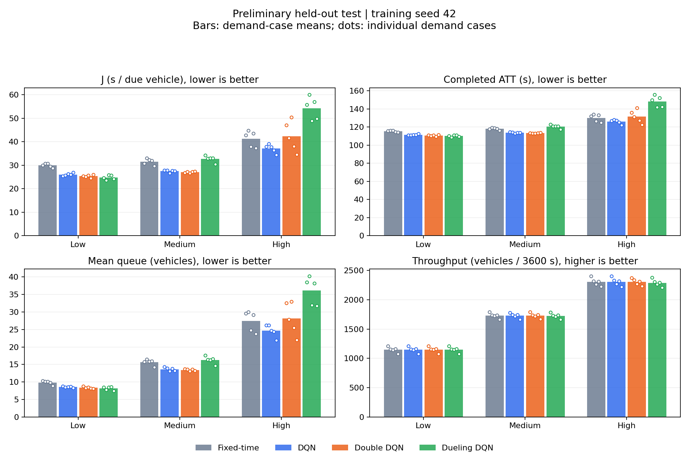
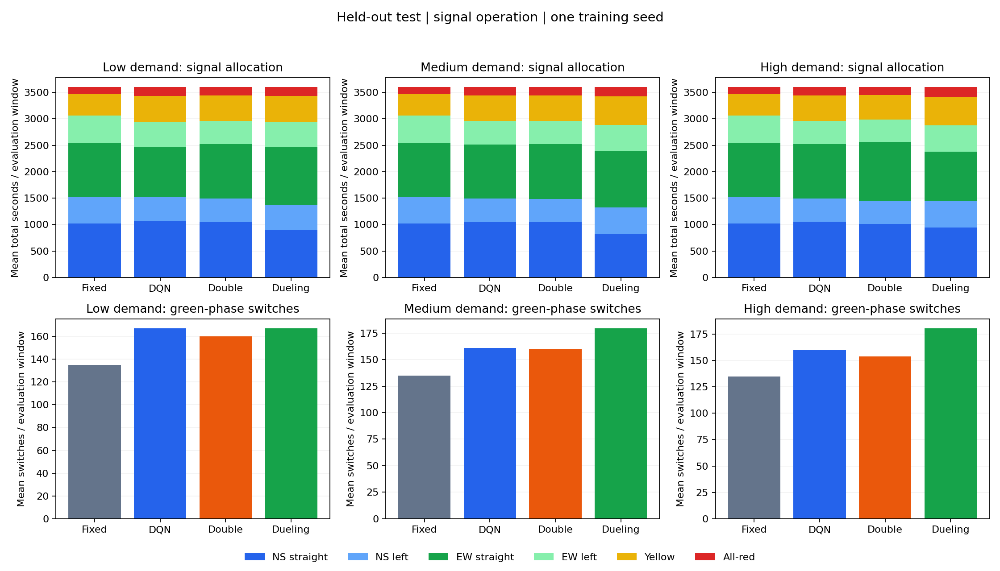
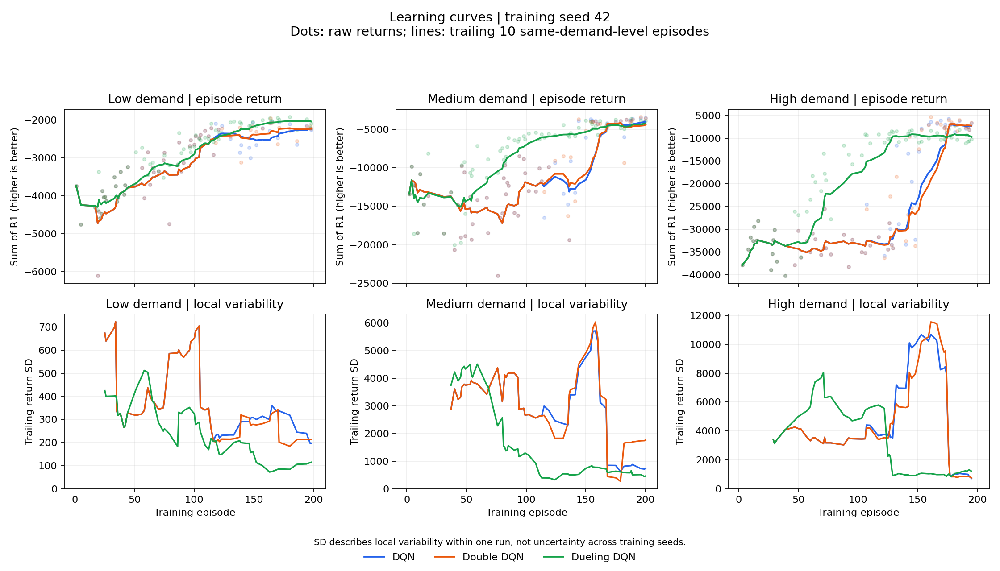
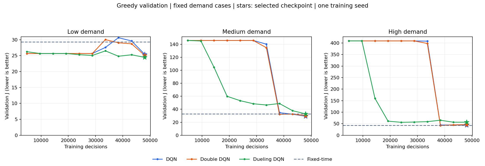

# 4현시 단일 교차로: DQN 계열 학습과 검증

확정한 S1(13차원), R1, 유지/전환 2행동, 15초 행동, 3,600초 외부 Truncation을 사용한다.
순수 PyTorch의 **DQN / Double DQN / 순수 Dueling DQN**을 같은 학습 루프에서 선택한다.
행동 선택·학습 타깃의 마스크, Replay, 수요 순서, 검증과 체크포인트 선정 규칙은 공통이다.

**코드 작성 과정에서 에이전트가 Python·SUMO·테스트·학습을 실행하지 않았다.** 사용자가 DQN 파일럿과
세 알고리즘의 시드 42·200에피소드 학습을 완료했고 저장 결과를 확인했다.
설치된 프로젝트 `.venv`의 PyTorch/Gymnasium/TraCI를 사용한다.

## 실험 결과 및 고찰 — 단일 학습 시드의 예비 평가

작성일: 2026-11-16. 아래 본문은 저장된 실험 결과를 바탕으로 작성한 보고서용 원고다.
평가 자료는 `results/fourphase_dqn/test_seed42`이며, 학습곡선은 `results/fourphase_dqn/learning_seed42`를 사용했다.
본문의 성능 수치는 별도 표시가 없는 한 독립 테스트 결과다. 검증 자료와 독립 테스트 자료를 구분하였다.

### 1. 실험 조건 및 평가 방법

본 연구는 SUMO 기반 가상 단일 교차로에서 DQN, Double DQN, 순수 Dueling DQN의 교통신호 제어 성능을
교통량 수준별로 비교하였다. 교차로는 네 방향의 진입로와 보호 좌회전을 포함한 4개 녹색 현시로 구성하였으며,
직진과 좌회전만 허용하였다. 세 강화학습 알고리즘에는 진입 정지차량 수 8개·현시 One-hot 4개·녹색 경과시간 1개로 구성한
13차원 관측, 유지/다음 현시 전환의 2개 행동,
15초 의사결정 간격과 동일한 R1 보상을 적용하였다. 황색 3초, 전적색 1초 및 최소·최대 녹색 제약도 동일하게 유지하였다.
R1은 진입 8개 차로의 정지차량 수를 매초 합산한 뒤 15초 동안 평균하여 음수를 취한 값이다.

각 알고리즘은 저·중·고 교통량을 에피소드 단위로 혼합하여 하나의 정책을 학습하였다.
학습 시드는 42로 고정하였으며, 모델당 200에피소드, 48,000회 의사결정과 47,000회 신경망 업데이트를 수행하였다.
교통량별 학습 에피소드 수는 저·중·고 각각 67·67·66회였고, 세 모델에 동일한 수요 순서와 배차 파일을 제공하였다.
Replay Buffer 용량 50,000, 배치 크기 32, 학습률 0.0005, 할인율 0.99, 초기 경험 수집 1,000행동 및
500행동 간격의 Target Network 복사를 공통으로 사용하였다. DQN과 Double DQN은 5,186개,
Dueling DQN은 5,251개의 파라미터를 가지며, Dueling에는 Double 타깃을 결합하지 않았다.

모델은 교통량별 3개 배차 시드로 구성된 검증 자료에서 평균 J가 가장 낮은 체크포인트를 선정하였다.
선정 이후에는 가중치를 고정하고 탐색률을 0으로 설정하여 평가하였다. 독립 테스트에는 학습·검증과 분리한
배차 시드 30000~30004를 사용하였다. 저·중·고 3개 교통량과 배차 시드 5개를 조합한 15개 수요를
Fixed-time 및 세 강화학습 모델에 공통으로 적용하여 총 60회 시뮬레이션을 수행하였다.
각 실행의 관측 길이는 3,600초였으며, 종료 시점은 지속적 제어 문제의 외부 시간 제한으로 처리하였다.
Fixed-time의 녹색시간은 남북 직진·남북 좌회전·동서 직진·동서 좌회전에 각각 30·15·30·15초를 적용하였다.

설정 유입률은 저·중·고 각각 1,200·1,800·2,400대/시간이며, 독립 테스트에서 실제 출발 예정 차량 수의
수요별 평균은 각각 1,186·1,790·2,397대였다. 이는 확률적 배차로 인해 설정 유입률과 차이가 발생한 것이다.
본 절의 저·중·고는 상대적 수요 수준을 구분하는 명칭으로, 교통용량 대비 포화도나 실제 도로의 서비스 수준을 뜻하지 않는다.

주요 대기 부담 지표는 `J = (W_stop,in + W_pending) / N_due`로 정의하였다.
`W_stop,in`은 진입 8개 차로의 정지차량-초, `W_pending`은 출발 예정 시각이 지났으나 진입하지 못한 차량의
누적 대기 차량-초, `N_due`는 관측 종료 이전에 출발할 예정이었던 차량 수이다. J의 단위는 초/예정 차량이며,
낮을수록 정지·미진입 대기 부담이 작다. 이 지표는 평균 이동시간 ATT와 구별하였다.
교통량별 결과는 배차 시드 5개의 실행별 지표를 동일 가중 평균하였으며, 전체 J는 세 교통량 평균에 동일한 가중치를 적용하였다.

모든 독립 평가 실행이 3,600초 관측, 차량 집계, 신호 및 충돌·Teleport 검사를 통과하였다.
비정상 실행과 미실행은 각각 0회였으며, 평가 전후 선정 모델과 입력 파일의 해시도 일치하였다.
따라서 이후 성능 비교는 실패 사례를 제외한 부분 평균이 아닌 계획된 60회 전체 결과에 근거한다.

### 2. 교통량별 대기 부담 비교

표 1은 교통량별 J를 나타낸다. `평균 ± 표준편차`의 표준편차는 같은 정책에 적용한 배차 시드 5개 사이의
표본 표준편차이며, 독립 학습 시드 사이의 변동이나 평균의 신뢰구간을 나타내지 않는다.

**표 1. 독립 테스트의 J 비교 — 초/예정 차량, 낮을수록 좋음**

| 제어기 | 저교통량 | 중교통량 | 고교통량 | 교통량별 동일 가중 평균 |
|---|---:|---:|---:|---:|
| Fixed-time | 29.94 ± 0.88 | 31.50 ± 1.30 | 41.24 ± 3.44 | 34.23 |
| DQN | 26.05 ± 0.55 | 27.48 ± 0.54 | **37.12 ± 1.80** | **30.22** |
| Double DQN | 25.36 ± 0.58 | **27.05 ± 0.37** | 42.30 ± 6.49 | 31.57 |
| Dueling DQN | **24.79 ± 0.98** | 32.74 ± 1.42 | 54.25 ± 4.79 | 37.26 |

저교통량에서는 Dueling DQN의 J가 24.79로 가장 낮았다. Fixed-time의 29.94와 비교하면 17.20% 감소하였으며,
Double DQN과 DQN도 각각 15.28%, 13.00%의 감소를 보였다. 이 조건에서는 세 강화학습 정책 모두
고정 신호보다 낮은 정지·미진입 대기 부담을 나타냈다.

중교통량에서는 Double DQN이 27.05로 가장 낮았고, DQN은 27.48로 그다음이었다.
Fixed-time 대비 감소율은 각각 14.14%, 12.75%였다. 반면 Dueling DQN은 32.74로,
Fixed-time의 31.50보다 3.95% 높았다. 저교통량에서 관측된 Dueling의 성능 우위는 중교통량에서는 유지되지 않았다.

고교통량에서는 DQN이 37.12로 가장 낮았으며, Fixed-time의 41.24보다 9.98% 감소하였다.
Double DQN은 42.30으로 Fixed-time보다 2.57% 높았고, Dueling DQN은 54.25로 31.56% 높았다.
따라서 **본 독립 테스트에서는 고교통량에서도 DQN이 가장 낮은 J를 기록하였다.**

전체 동일 가중 평균 J는 DQN 30.22, Double DQN 31.57, Fixed-time 34.23, Dueling DQN 37.26 순이었다.
Fixed-time 대비 평균 J 감소율은 DQN 11.71%, Double DQN 7.76%였으며, Dueling DQN은 8.87% 증가하였다.
이는 교통량 조건에 따라 동일한 알고리즘의 상대적 성능이 달라질 수 있음을 보여준다.
다만 각 교통량에서 가장 좋은 정책을 따로 골라 하나의 성능으로 합치지 않았으며,
모든 교통량에 동일한 검증 선정 체크포인트를 적용한 결과를 보고하였다.

### 3. 이동시간·대기열·처리량 및 미완료 차량

표 2는 완료 차량의 평균 이동시간 ATT, 평균 진입 대기열 AQL 및 처리량을 제시한다.
ATT는 각 실행에서 목적지에 도착한 차량의 평균 이동시간을 계산한 뒤 실행별 평균에 동일한 가중치를 부여하였다.
처리량은 3,600초 관측 구간 안에 도착한 차량 수이며, 평균 차량 수의 소수점은 5회 실행 평균에서 발생한다.

**표 2. 독립 테스트의 교통 성능 지표**

| 교통량 | 제어기 | ATT (초) | AQL (대) | 처리량 (대/3,600초) |
|---|---|---:|---:|---:|
| 저 | Fixed-time | 115.32 | 9.86 | 1,150.6 |
| 저 | DQN | 111.43 | 8.57 | 1,150.6 |
| 저 | Double DQN | 110.55 | 8.34 | 1,150.2 |
| 저 | Dueling DQN | 110.10 | 8.16 | 1,150.4 |
| 중 | Fixed-time | 118.02 | 15.64 | 1,730.6 |
| 중 | DQN | 113.84 | 13.64 | 1,730.2 |
| 중 | Double DQN | 113.26 | 13.42 | 1,732.4 |
| 중 | Dueling DQN | 120.52 | 16.27 | 1,724.6 |
| 고 | Fixed-time | 130.12 | 27.45 | 2,303.4 |
| 고 | DQN | 125.96 | 24.69 | 2,307.6 |
| 고 | Double DQN | 131.66 | 28.16 | 2,304.0 |
| 고 | Dueling DQN | 148.32 | 36.13 | 2,290.6 |

DQN은 세 교통량 모두에서 Fixed-time보다 ATT와 AQL이 낮았다. ATT 감소율은 저·중·고 각각
3.37%, 3.54%, 3.20%였으며, AQL 감소율은 13.11%, 12.78%, 10.07%였다.
반면 처리량 변화는 저교통량에서 0.00%, 중교통량에서 -0.02%, 고교통량에서 +0.18%로 작았다.
따라서 본 수요 범위에서 DQN의 주요 효과는 차량의 정지 부담과 이동시간 감소로 나타났으며 처리량 변화는 작았다.

Dueling DQN의 고교통량 ATT는 148.32초로 Fixed-time보다 13.98% 길었으며,
AQL은 36.13대로 31.61% 높았다. 이 결과는 J 증가가 평균 이동시간과 대기열 증가를 동반하였음을 보여준다.
다만 J와 AQL은 모두 진입차로 정지차량-초를 사용하므로 두 지표의 동반 변화가 서로 완전히 독립적인 증거는 아니다.
완료 차량 ATT와 차량 집계를 함께 확인하여 결과를 해석하였다.

**표 3. 고교통량에서 종료 시점의 잔여 차량 및 미진입 대기 부담 — 실행별 평균**

| 제어기 | 도로 내 미완료 차량 (대) | 출발 예정 미진입 차량 (대) | 미진입 누적 대기 (차량·초) |
|---|---:|---:|---:|
| Fixed-time | 93.4 | 0.2 | 186.8 |
| DQN | 89.2 | 0.2 | 187.6 |
| Double DQN | 92.8 | 0.2 | 186.6 |
| Dueling DQN | 106.2 | 0.2 | 187.4 |

저·중교통량에서는 모든 제어기의 종료 시점 미진입 차량 평균이 0대였으며,
고교통량에서도 네 제어기 모두 0.2대로 같았다. 이 조건에서 DQN의 낮은 J와 AQL이
더 많은 차량을 네트워크 밖에 남겨서 얻어진 결과라는 증거는 관측되지 않았다.
Dueling은 고교통량에서 미완료 차량이 평균 106.2대로 가장 많았으며,
처리량 감소와 ATT 증가도 함께 나타났다. 따라서 완료 차량만의 ATT를 보더라도 누락될 수 있는 잔여 차량의 부담을 별도로 제시하였다.
관측 종료 직전 출발한 차량도 포함되므로 미완료 차량의 존재 자체를 시뮬레이션 실패로 판단하지 않았다.



그림 1의 막대는 배차 시드 5개 평균이고 점은 개별 수요 결과다. 특히 고교통량에서 Double DQN의 J 표준편차는
6.49로 DQN의 1.80보다 컸다. 이는 이번에 선정된 두 정책의 평가 수요에 대한 반응 차이를 나타내며,
Double DQN의 학습 시드 간 안정성이 더 낮다는 결론으로 확장하지 않았다.

### 4. 신호 운영 차이에 대한 고찰

고교통량의 성능 차이를 해석하기 위해 전환 횟수와 현시별 누적 시간을 비교하였다.
표 4의 시간은 3,600초 관측 구간에서 해당 현시가 켜진 총 시간을 구한 뒤 배차 시드 5개에 대해 평균한 값이다.
관측 시작·종료 경계에서 현시가 잘릴 수 있으므로 평균 녹색 한 번의 지속시간이나 완전한 한 주기의 Split과 구별하였다.

**표 4. 고교통량의 신호 운영 통계 — 3,600초 관측 구간 기준**

| 제어기 | 전환 횟수 | 남북 직진 (초) | 남북 좌회전 (초) | 동서 직진 (초) | 동서 좌회전 (초) | 황색·전적색 합 (초) |
|---|---:|---:|---:|---:|---:|---:|
| Fixed-time | 135.0 | 1,020.0 | 510.0 | 1,020.0 | 510.0 | 540.0 |
| DQN | 160.0 | 1,055.0 | 440.0 | 1,025.0 | 440.0 | 640.0 |
| Double DQN | 153.8 | 1,015.0 | 426.8 | 1,122.8 | 420.2 | 615.2 |
| Dueling DQN | 180.4 | 944.4 | 499.4 | 937.4 | 497.2 | 721.6 |

Dueling DQN의 고교통량 평균 전환 횟수는 180.4회로 Fixed-time의 135회보다 45.4회 많았다.
이에 따라 황색·전적색의 누적 시간은 540.0초에서 721.6초로 181.6초 증가하였다.
전체 관측 구간에서 황색·전적색이 차지하는 비중은 각각 15.00%, 20.04%였다.
Dueling의 직진 녹색 총합은 1,881.8초로 Fixed-time의 2,040.0초보다 158.2초 짧았다.
직진 수요의 기대 비중을 75%로 설정한 본 실험에서 이러한 운영 차이는 고교통량 대기열 증가에 기여했을 가능성이 있다.

그러나 전환 횟수만으로 성능을 설명하기는 어렵다. DQN 역시 Fixed-time보다 전환 횟수와 황색·전적색 시간이 많았지만,
J·ATT·AQL은 더 낮았다. DQN은 좌회전 녹색 총합을 1,020.0초에서 880.0초로 줄이는 한편,
직진 녹색 총합을 2,040.0초에서 2,080.0초로 늘렸다. 또한 남북·동서 직진 녹색을 각각 1,055.0초와 1,025.0초로 배분하였다.
따라서 이번 성능 차이는 전환 빈도와 함께 이동류별·방향별 녹색 배분을 고려하여 해석할 필요가 있다.

Double DQN의 직진 녹색 총합은 2,137.8초로 DQN보다 많았으나 J는 더 높았다.
이는 녹색 총량 증가만으로 성능 향상을 보장할 수 없음을 보여준다.
현시가 주어지는 시점과 방향별 배분, 해당 시점의 차로별 대기 상태를 함께 분석해야 하며,
현재 집계 통계만으로 특정 방향의 녹색 부족이나 특정 전환을 직접 원인으로 확정하지 않았다.
전환 빈도나 녹색 배분을 독립적으로 조작한 추가 검증을 수행하지 않았으므로,
위 설명은 관측된 신호 운영과 교통 성능 사이의 관계에 근거한 가능한 해석이다.



### 5. 학습 과정과 안정성에 대한 고찰

학습 중에는 에피소드별 교통량이 달라지므로, 보상합을 저·중·고로 분리하여 원시 값과
동일 교통량의 최근 10에피소드 이동평균·표본 표준편차를 확인하였다.
세 알고리즘 모두 학습 후반에 초기보다 높은, 즉 덜 음수인 보상을 보였으며,
일부 큰 변동 구간을 거친 뒤 최근 보상 변동이 줄어드는 양상이 관측되었다.
다만 학습 수요 시드와 탐색 행동도 함께 변하므로 이 곡선만으로 정책의 완전한 수렴을 주장하지 않았다.



탐색을 제거하고 고정된 검증 수요 9개에서 평가한 결과, Dueling DQN의 검증 평균 J는
60에피소드에서 96.66, 80에피소드에서 48.92로 감소하여 DQN과 Double DQN보다 이른 검증 성능 개선을 보였다.
반면 DQN과 Double DQN은 120에피소드까지 검증 평균 J가 193.42로 유지되다가,
160에피소드에서 각각 36.62와 34.47로 크게 감소하였다.
검증 성능이 일정한 구간에도 신경망 업데이트는 수행되었으므로 이를 학습이 전혀 일어나지 않은 구간으로 해석하지 않았다.

초기 검증 성능 개선이 빠른 Dueling이 최종 독립 테스트에서도 가장 좋은 것은 아니었다.
200에피소드의 검증 평균 J는 DQN 32.79, Double DQN 33.83, Dueling DQN 38.04였으며,
독립 테스트의 전체 평균 J도 같은 순서를 보였다. Double DQN은 검증 J가
160에피소드 34.47에서 180에피소드 35.50으로 증가한 뒤 200에피소드 33.83으로 감소하여,
학습 예산 증가에 따라 성능이 단조롭게 개선되지는 않았다.



검증 고교통량에서는 Fixed-time의 J가 43.05로 DQN의 43.64보다 낮았지만,
독립 테스트에서는 DQN 37.12, Fixed-time 41.24로 순서가 달라졌다.
이는 평가 수요 구성에 따른 차이를 함께 고려해야 함을 보여주며, 검증과 테스트의 수치를 혼합하여 보고하지 않았다.

학습 진단에서는 Dueling의 후반 Huber Loss가 DQN·Double DQN보다 낮은 양상을 보였지만,
고교통량의 독립 테스트 성능은 오히려 가장 나빴다. 따라서 Loss의 크기만으로 교통 제어 성능을 판단할 수 없다.
Q값과 부트스트랩 타깃은 학습 중 계속 바뀌며 모델마다 Replay 내용도 달라지므로,
Loss와 배치 평균 Q의 차이를 정책 성능이나 Q값 추정 정확도의 직접 지표로 사용하지 않았다.
관련 원시 추세는 [학습 진단 그래프](../results/fourphase_dqn/learning_seed42/training_diagnostics.png)에 제시하였다.

세 모델 모두 마지막 200에피소드의 체크포인트가 선정되었다는 점에서,
현재 결과는 정해진 예산 안에서 얻은 성능이며 충분한 예산에서 완전히 수렴한 성능의 비교라고 보기는 어렵다.
또한 현재 학습 시드는 하나이므로 최근 보상 표준편차나 검증 수요 간 표준편차를
독립 학습 반복의 안정성 또는 알고리즘 간 통계적 유의성으로 해석하지 않았다.

### 6. 연구의 시사점과 제한점

본 예비 실험에서 DQN은 세 교통량 모두에서 Fixed-time보다 낮은 J를 기록하였고,
고교통량 및 전체 동일 가중 평균에서 네 제어기 중 가장 낮은 값을 보였다.
저교통량에서는 Dueling, 중교통량에서는 Double이 가장 낮았다.
이는 동일한 상태·행동·보상과 학습 예산을 적용하더라도 수요 수준에 따라 상대적 성능이 달라질 수 있음을 보여준다.
본 프로젝트의 비교에서는 모델 구조의 복잡성이나 초기 학습 속도만으로 최종 교통 제어 성능을 예측하기 어려웠다.

해석 범위에는 다음 제한이 있다. 첫째, 각 알고리즘을 학습 시드 42에서 한 번씩만 학습하였으므로,
신경망 초기화·탐색·Replay 샘플링에 따른 학습 결과의 변동을 충분히 평가하지 못하였다.
배차 시드 5개는 선택된 정책의 수요 변동을 평가한 것이며 5개의 독립 학습 실행을 의미하지 않는다.
후속 본 실험에서는 사전에 정한 동일 프로토콜로 추가 학습 시드를 반복하여 평균과 학습 시드 간 변동을 보고할 필요가 있다.

둘째, 가상 단일 교차로, 기대 직진/좌회전 비율 75:25 및 세 개의 설정 유입률에 한정된 결과다.
실제 교차로의 운영값이나 현장 교통량으로 보정하지 않았으며,
유입률 1,200·1,800·2,400대/시간을 실제 도로의 혼잡 등급이나 검증된 포화도 구간으로 일반화할 수 없다.
초기화된 교통 상태에서 시작한 1시간 관측 결과와 장시간 연속 운영의 성능도 구별해야 한다.
Fixed-time은 사전에 정한 30·15·30·15초의 단일 시간표이므로 모든 고정시간 최적화 방식에 대한 우위를 의미하지 않는다.

셋째, 13차원 관측은 정지차량 수·현시·녹색 경과시간으로 교통 상태를 압축하므로
접근 차량의 속도·위치 및 외부 대기 상태를 완전하게 표현하지 않는다.
R1 학습 보상은 진입차로 정지 부담을 사용하고 모델 선정 지표 J는 미진입 대기를 추가하므로 두 목적은 완전히 같지 않다.
본 테스트에서는 종료 시점 미진입이 적어 외부 대기 부담이 크게 누적되는 조건까지 충분히 검증하지 못하였다.

넷째, 신호 운영 통계는 성능 차이를 설명할 수 있는 관측 근거이나,
전환 횟수·방향별 녹색 배분·대기열 변화의 인과효과를 분리한 실험은 수행하지 않았다.
따라서 Dueling의 고교통량 성능 저하를 전환 빈도 증가 하나로 단정하지 않으며,
추가 분석이 필요한 가설과 현재 수치로 확인된 사실을 구분하였다.

이러한 범위에서 본 연구는 공통 실험 조건 아래 교통량별 성능 차이와 신호 운영 특성을 함께 비교하는 예비 결과를 제시하였다.
현재 독립 테스트 결과로 체크포인트·보상·설정을 다시 선택하지 않으며,
추가 학습 시드 반복은 별도로 유지한 본 실험 계획에 따라 진행한다.

### 결과 근거 및 그림 원본

| 용도 | 원본 자료 |
|---|---|
| 평가 조건·선정 모델·입력 해시 | [protocol.json](../results/fourphase_dqn/test_seed42/protocol.json) |
| 60회 완료·비정상/미실행 집계·전체 J | [summary.json](../results/fourphase_dqn/test_seed42/summary.json) |
| 표 1~3의 평균·표준편차·차량 집계 | [comparison.csv](../results/fourphase_dqn/test_seed42/comparison.csv) |
| Fixed-time 대비 변화율 | [improvement.csv](../results/fourphase_dqn/test_seed42/improvement.csv) |
| 표 4의 신호 시간·전환 횟수 | [signal_operation.csv](../results/fourphase_dqn/test_seed42/signal_operation.csv) |
| 개별 배차 수요의 평가 지표 | [cases.csv](../results/fourphase_dqn/test_seed42/cases.csv) |
| 보상 원시 값·이동평균·최근 표준편차 | [learning_episodes.csv](../results/fourphase_dqn/learning_seed42/learning_episodes.csv) |
| 구간별 Loss·배치 Q/타깃·학습 진행 | [learning_updates.csv](../results/fourphase_dqn/learning_seed42/learning_updates.csv) |
| DQN 학습 예산·파라미터·완료 상태 | [training_summary.json](../results/fourphase_dqn/main_seed42/training_summary.json) |
| Double DQN 학습 예산·완료 상태 | [training_summary.json](../results/fourphase_dqn/double_seed42/training_summary.json) |
| Dueling DQN 학습 예산·파라미터·완료 상태 | [training_summary.json](../results/fourphase_dqn/dueling_seed42/training_summary.json) |
| 학습 중 검증 성능 변화 | [DQN](../results/fourphase_dqn/main_seed42/validations.jsonl), [Double](../results/fourphase_dqn/double_seed42/validations.jsonl), [Dueling](../results/fourphase_dqn/dueling_seed42/validations.jsonl) |

## 독립 수요 평가 실행 방법

사용자가 검증 비교표와 학습곡선 생성을 완료했다. 추가 학습 시드 43·44는 나중으로 미루고,
학습 시드 42의 검증 선정 모델 3개를 고정한 채 Fixed-time과 같은 독립 테스트 수요에서 비교한다.
**평가는 사용자가 완료했으며, 에이전트가 프로그램을 실행하지는 않았다.**

새 평가가 필요한 경우 **원격 Linux VS Code 터미널**에서 검사가 통과한 뒤 새 출력 경로로 실행한다.

```bash
cd "/path/to/RL/experiments/fourphase-dqn-comparison"
.venv/bin/python -m unittest discover -s tests -p 'test_fourphase*.py' -v
.venv/bin/python scripts/evaluate_fourphase_models.py --output results/fourphase_dqn/test_seed42_v2
```

이 명령은 Linux의 화면 없는 SUMO를 사용한다. Mac SUMO와 SSH 터널은 필요 없다.
출력 폴더가 있으면 덮어쓰지 않으므로 새 `--output` 경로를 지정한다.

- 학습 폴더는 `main_seed42`, `double_seed42`, `dueling_seed42`다. 검증 J로 선정한 `best_model.pt`만 불러온다.
- 평가용 배차 시드 `30000~30004` × 저·중·고 = **15개 수요**를 사용한다. 신경망 학습 시드는 42로 유지한다.
- Fixed-time 15회 + 세 모델 각 15회 = **총 60회**다. 탐색률 ε=0이며 신경망·Replay·Optimizer를 업데이트하지 않는다.
- 기존에 저장한 테스트 입력을 사용한다. 모든 제어기에 같은 도로·배차·SUMO 난수 시드를 제공한다.
- 검증의 최소 J 선정, 모델·입력 파일 해시, 학습/검증/테스트 수요 분리를 실행 전에 검사하고 `protocol.json`을 저장한다.
- 테스트 결과로 체크포인트나 설정을 다시 고르지 않는다. 결과는 **단일 학습 시드의 독립 수요 예비 평가**다.

`results/fourphase_dqn/test_seed42/`에 생성되는 파일:

| 파일 | 내용 |
|---|---|
| `protocol.json` | 실행 전 고정한 선정 모델·해시·공통 테스트 수요·평가 규칙 |
| `summary.json` | 정상/실패 상태, 완료·비정상·미실행 횟수, 전체 J |
| `comparison.csv`, `comparison.json` | 4개 제어기 × 교통량 3개 비교와 원시 평가 요약 |
| `cases.csv` | 60개 실행별 지표·차량 집계·신호 누적 시간 |
| `improvement.csv` | Fixed-time 대비 J·ATT·AQL 감소율, 처리량 증가율; 양수는 개선 |
| `traffic_metrics.png` | 독립 테스트의 J·ATT·AQL·처리량 비교 |
| `signal_operation.csv`, `signal_operation.png` | 4현시 녹색·황색·전적색 누적 시간과 전환 횟수 |
| `fixed/summary.json`, `dqn/summary.json` 등 | 제어기별 15회 평가 기록 |
| `fixed/low_seed_30000/metrics.json`, `tripinfo.xml` 등 | 실행별 검사·완료/미완료 차량 기록 |

신호 시간은 각 3,600초 관측 구간에서 해당 현시가 켜진 **총 시간의 수요별 평균**이다.
관측 경계에서 잘리는 녹색이 있으므로 평균 녹색 1회의 지속시간으로 해석하지 않는다.
CSV의 `sd_demand`와 그래프의 점은 평가 배차 시드 사이의 차이를 나타내며 학습 시드 간 신뢰구간은 아니다.
ATT는 완료 차량 기준이므로 미완료·미진입과 처리량을 함께 확인한다.

정상 완료는 루트 `summary.json`의 `status="completed"`, `completed=60`, `abnormal=0`, `unattempted=0`이다.
충돌·Teleport·프로그램 오류가 발생하면 첫 비정상 실행에서 중단하고 완료/비정상/미실행 횟수와 원인을 남긴다.
부분 실행의 정상 사례만 모아 최종 비교표를 만들지 않는다. 실제 혼잡·미진입·미완료가 많아지는 것은 유효한 성능 결과다.
원래 학습 폴더의 `training_summary.json`은 변경하지 않으며 새 독립 평가의 완료 여부는 이 평가 폴더에서 확인한다.

평가가 끝난 뒤 그래프 형식을 바꾸거나, `comparison.json`이 저장된 상태에서 그래프 생성만 실패했다면:

```bash
.venv/bin/python scripts/evaluate_fourphase_models.py --report-only results/fourphase_dqn/test_seed42
```

이 옵션은 저장된 60회 결과를 다시 검사해 보고서만 생성한다. SUMO·모델 추론을 재실행하지 않는다.

## 완료된 학습·검증 결과와 보고서

`results/fourphase_dqn/` 아래 `main_seed42`, `double_seed42`, `dueling_seed42`의 `training_summary.json`에서
세 학습의 정상 완료를 확인했다. **각각** 200에피소드, 48,000개 행동, 47,000회 optimizer 업데이트,
Target 복사 96회다. 학습 200회와 검증 90회(10개 체크포인트 × 9개 수요)의 검사가 모델마다 모두 통과했다.
세 모델 모두 200에피소드의 `best_model.pt`가 선정됐으며, 모델·검증 요약 해시도 일치한다.
알고리즘 이름을 제외한 학습 설정과 200개 학습 순서, 학습·검증·테스트 수요 입력 해시가 동일하다.

| 검증 교통량 | Fixed-time J | DQN J | Double DQN J | 순수 Dueling J |
|---|---:|---:|---:|---:|
| Low | 29.3052 | 25.4374 | 25.0810 | **24.4645** |
| Medium | 32.9180 | **29.2777** | 30.1722 | 32.9097 |
| High | **43.0516** | 43.6438 | 46.2465 | 56.7460 |
| 수준별 동일 가중 평균 | 35.0916 | **32.7863** | 33.8332 | 38.0401 |

J의 단위는 초/예정 차량이며 낮을수록 좋다. Fixed 값은
`results/fourphase_dqn/pilot_seed42/comparisons/validation_20261115T114057199164Z/comparison.json`에서 가져왔다.
세 학습 폴더와 기존 파일럿 manifest에서 도로와 검증 수요 9개의 입력 해시가 동일함을 확인했으므로 같은 Fixed 결과를 재사용한다.
현재 시드의 검증 평균은 DQN이 가장 낮지만, 저교통량은 Dueling, 고교통량은 Fixed-time이 가장 낮다.
이는 **학습 시드 42 하나의 검증 결과**이므로 알고리즘의 일반적 우열을 확정하지 않는다.
별도의 독립 테스트 결과는 이 문서 위쪽에 구분하여 기록했다.

**검증 보고서:** 사용자는 시드 43·44의 추가 학습을 나중으로 미뤘다. 완료된 학습 시드 42의
세 모델과 기존 Fixed-time의 검증 결과를 모은 **예비 비교표·그래프**도 보존한다.
`scripts/report_fourphase.py`는 기존 파일만 읽고 신경망·SUMO·최종 테스트를 실행하지 않는다.
모델마다 `selection.json`이 가리키는 검증 결과를 사용하고 모델/요약/수요 해시와 실행 검사를 확인한다.

**원격 Linux VS Code 터미널:**

```bash
cd "/path/to/RL/experiments/fourphase-dqn-comparison"
.venv/bin/python -m unittest discover -s tests -p 'test_fourphase_report.py' -v
.venv/bin/python -m unittest discover -s tests -p 'test_fourphase_learning.py' -v
.venv/bin/python scripts/report_fourphase.py --output results/fourphase_dqn/learning_seed42
```

에이전트가 보고 코드와 검사를 실행하지는 않았으며, 사용자가 `learning_seed42` 보고서 생성을 완료했다.
아래 파일은 기존 생성 결과이며 재생성할 때는 새 출력 경로를 지정한다.
Mac SUMO와 SSH 터널은 필요 없다. 기존 `preview_seed42` 보고서는 보존한다.
출력 폴더가 이미 있다면 `--output results/fourphase_dqn/learning_seed42_v2`처럼 새 경로를 지정한다.

| 파일 | 내용 |
|---|---|
| `comparison.csv` | 4개 제어기 × 3개 교통량의 J·ATT·AQL·처리량·미진입/미완료·전환 횟수 |
| `cases.csv` | 검증 수요별 원시 지표 36개 행 |
| `comparison.json` | 집계·모델 선택 정보·원본 해시·예비 검증 표시 |
| `traffic_metrics.png` | 교통량별 J·ATT·AQL·처리량 비교 |
| `validation_curves.png` | 동일 학습 예산에서의 검증 J 곡선 |
| `learning_curves.png` | 교통량별 원시 에피소드 보상·10회 이동평균·최근 보상 표준편차 |
| `training_diagnostics.png` | Loss 평균/p90, 배치 Q/타깃, 탐색률 ε, Replay/업데이트 진행 |
| `validation_by_level.png` | 저·중·고별 검증 J 변화와 선정 체크포인트 |
| `learning_episodes.csv` | 원시 보상과 교통량별 이동평균·표준편차에 사용한 값 |
| `learning_updates.csv` | 500행동 단위로 집계한 학습 진단 수치 |

VS Code 탐색기에서 PNG를 열어 확인한다. 막대는 배차 시드 3개의 평균, 점은 각각의 배차 수요다.
CSV의 `sd_demand` 역시 **배차 수요 간 변동**이며 독립 학습 시드 반복의 오차가 아니다.
ATT는 완료 차량의 시뮬레이션별 평균을 다시 동일 가중 평균하고, 미진입·미완료 차량 수를 별도 유지한다.
현재 표와 그래프는 체크포인트 선정에 사용한 검증 자료이며 최종 테스트 성능으로 해석하지 않는다.
나중에 시드 43·44의 독립 학습 반복과 확정 모델의 독립 테스트를 진행한다.

### 학습곡선에서 안정성을 읽는 방법

`learning_curves.png`의 위쪽은 에피소드 보상합 `ΣR1`이다. 모든 에피소드가 240행동이므로
에피소드 평균 R1의 240배이며, 값이 커져 0에 가까워질수록 진입차로 정지 부담이 줄었다는 뜻이다.
저·중·고 수요는 보상 크기 자체가 다르므로 세 열로 나눠 같은 수요 수준 안에서 비교한다.
점은 원시 보상, 선은 **같은 교통량의 최근 10에피소드** 이동평균이다. 처음에는 확보된 관측만으로 평균을 계산한다.

아래쪽은 같은 10회 보상합의 표본 표준편차다. 해당 교통량 관측이 10회 미만이면 값을 비워 두며,
초기 구간을 표준편차 0으로 표현하지 않는다. 이는 **하나의 학습 실행에서의 최근 변동**이다.
배차 시드·탐색률·학습 중인 정책이 모두 달라지므로 신뢰구간이나 독립 학습 시드 간 안정성으로 해석하지 않는다.

`training_diagnostics.png`에서는 500행동 구간별 Loss 평균(실선)과 그 구간 업데이트 Loss의 90백분위(점선)를 표시한다.
초기 1,000행동은 학습하지 않았으므로 Loss가 빈 구간이다. 실제 Loss 0과 구분한다.
Q/타깃은 Replay에서 뽑은 배치의 **기록된 평균**이며 실제 수익과 비교한 과대추정량은 아니다.
보상이 음수이므로 Q값도 음수일 수 있으며, 절댓값의 증가만으로 발산 여부를 판단하지 않는다.
이동하는 부트스트랩 타깃과 바뀌는 Replay 분포 때문에 Loss가 계속 감소하거나 0이 되어야만 정상인 것은 아니다.
보상·검증 성능·값의 변화와 함께 해석한다. 서로 같은 ε·Replay·업데이트 스케줄의 선이 겹치는 것은 정상이다.

ε는 최초 1,000행동의 균등 무작위 수집을 반영한 실제 행동 탐색률이다.
로그의 ε가 행동 후 카운터 기준인 점을 보정하여 다음 행동에 사용된 값을 연결한다.
회색 배경은 초기 수집 구간이며, 새로운 학습이나 모델 평가를 수행하지 않는다.
최종 ε도 0.05이므로 학습 중에는 탐색 행동이 남는다. 보상 표준편차가 0이 될 필요는 없다.

`validation_curves.png`와 `validation_by_level.png`는 탐색 없이 같은 검증 수요를 사용한 원시 J를 표시한다.
수준별 곡선의 별표는 공통 검증 평균 J로 선정한 체크포인트다. 수준별로 다른 모델을 고른 것이 아니다.
현재 세 모델 모두 마지막 200에피소드가 선정됐으므로, 현재 예산에서 개선됐다는 결과와
충분히 수렴했다는 주장은 구분한다. 보상 추세가 좋아져도 검증 J가 나빠지거나 큰 진동이 지속되는지 함께 확인한다.

## 알고리즘별 변경점

| 알고리즘 / `--algorithm` | Q-network | 다음 상태의 학습 타깃 |
|---|---|---|
| DQN / `dqn` | 13 → 64 → 64 → 2 | 유효 행동 중 Target Q 최대값 |
| Double DQN / `double_dqn` | DQN과 동일 | Online으로 유효 행동 선택 → Target으로 평가 |
| 순수 Dueling / `dueling_dqn` | 공통 13 → 64 → 64 뒤 V(1), A(2) | DQN과 동일; Double 타깃 사용 안 함 |

Dueling은 `Q=V+A-mean(A)`를 사용한다. DQN/Double 파라미터는 5,186개, Dueling은 5,251개다.
기존 DQN 체크포인트 형식과 네트워크는 유지하므로 완료된 모델을 그대로 읽을 수 있다.
새 검사는 Double의 행동 선택/가치 평가 분리, Dueling 합성식, 세 모델의 마스크·수요 순서·저장/불러오기를 확인한다.

## 처음부터 시작하는 경우: DQN 파일럿

계산 검사는 가짜 TraCI/텐서만 사용하며 SUMO를 실행하지 않는다.

```bash
cd "/path/to/RL/experiments/fourphase-dqn-comparison"
.venv/bin/python -m unittest discover -s tests -p 'test_fourphase*.py' -v
```

기존에 생성한 `sumo/fourphase` 도로를 사용해 **20에피소드 파일럿**을 시작한다.

```bash
.venv/bin/python scripts/train_fourphase_dqn.py --episodes 20 --seed 42 --output results/fourphase_dqn/pilot_seed42
```

학습은 Linux의 화면 없는 SUMO를 사용한다. Mac GUI/SSH 터널은 학습에 필요하지 않다.
출력 폴더가 이미 있으면 덮어쓰지 않는다. 재실행은 `--output results/fourphase_dqn/pilot_seed42_v2`처럼 새 경로를 지정한다.

20 × 240 = **4,800개 transition**, 모든 에피소드가 통과하면 **3,800회 optimizer 업데이트**를 수행한다.
초기 네트워크 복사를 제외한 Target hard copy는 500~4,500번째 decision에서 **9회**다.
이는 파일럿 예산이다. 사용자는 이후 새 폴더 `main_seed42`에서 DQN 200에피소드 학습도 완료했다.

## 고정한 학습 설정

| 항목 | 값 |
|---|---|
| 공통 feature 층 | 13 → 64 → ReLU → 64 → ReLU; 출력은 위 알고리즘별 표 참조 |
| Optimizer / lr | Adam / 0.0005 |
| Loss / γ | Huber / 0.99, 15초 행동 기준 |
| Replay 상한 / minibatch | 50,000 / 32 |
| 초기 수집 | 최초 1,000개 행동은 유효 행동 중 균등 무작위; 업데이트 없음 |
| 신경망 업데이트 | 1,001번째 행동부터 매 행동 후 1회 |
| Target 복사 | 전체 행동 500회마다 hard copy, optimizer 횟수와 구별 |
| ε 스케줄 | 전체 행동 카운터 기준 1.0 → 0.05, 예산의 처음 70%에 선형 감소 |
| 파일럿 ε 종료 | 3,360번째 행동에서 0.05; 초기 수집 동안 실제 행동은 계속 균등 무작위 |
| 200에피소드 ε 종료 | 33,600번째 행동에서 0.05 |
| 검증 | 20에피소드마다, 마지막 에피소드도 검증 |
| CPU 설정 | 기본 CPU, PyTorch 스레드 1개 |

파일럿에서는 최초 4에피소드 동안 업데이트가 없는 것이 정상이며, 5번째 에피소드에서 학습이 시작된다.
환경 reset 후에도 동일한 Agent 인스턴스의 Online/Target/Adam/Replay/난수 상태/전체 카운터를 유지한다.
모든 epsilon 탐색·탐욕 선택과 Target 행동 선택에서 같은 유효 행동 마스크를 적용한다.

`terminated`만 미래 가치를 제거한다. 마지막 Truncation transition에는 **reset 이전 실제 next_state와 next_action_mask**를 복사 저장한다.
종료 보너스·페널티·보상 clipping은 없다. R1은 진입 8차로 정지차량의 15초 평균 음수이며,
매 에피소드 `W_stop,in=-15×Σr`와 차량 집계를 검사한다.

## 수요 분리와 모델 선택

- **학습:** 매 에피소드 새 배차 시드 `10000, 10001, …`; 저·중·고를 최대 1에피소드 차이로 균형 배정한 뒤 별도 RNG로 섞고 `manifest.json`에 순서를 저장한다. 20회는 7/7/6회, 200회는 67/67/66회다. 같은 학습 시드·에피소드 수에서 알고리즘과 무관하게 동일하다.
- **검증:** `20000/20001/20002` × 저·중·고 = 9개 고정 수요.
- **최종 테스트 예약:** `30000~30004` × 저·중·고 = 15개. 입력만 만들고 이번 학습·비교 명령에서는 실행하지 않는다.
- 도로 파일럿 수요 시드 42는 어느 split에도 넣지 않는다. **신경망 학습 시드 42와 배차 시드는 다른 설정**이다.
- ±10% 수요 변동은 이번 기본 파일럿에서 사용하지 않는다. 생성된 실제 배차 목록·입력 해시를 보존한다.

세 수준별 J 평균을 구하고, 수준별 동일 가중 평균이 최소인 체크포인트를 선택한다.
`J=(W_stop,in+W_pending)/N_due`. ATT나 처리량을 보고 모델을 교체하지 않는다. 동률이면 앞선 체크포인트를 유지한다.
20에피소드 파일럿은 검증 지점이 마지막 한 번이므로 `best_model.pt`와 마지막 학습 가중치가 같다.

충돌·Teleport·차량 집계 오류·비정상 수치가 발생하면 기록 후 학습을 중단한다.
미진입/미완료가 많거나 혼잡해지는 것은 유효한 성능 결과로 유지한다. 비정상 시드를 조용히 제외하지 않는다.

## 생성되는 파일

`results/fourphase_dqn/pilot_seed42/`:

| 파일 | 용도 |
|---|---|
| `manifest.json`, `training_config.json`, `env_settings.json` | 도로 해시, 학습 순서, 수요 분리, 확정 설정 |
| `scenarios/train`, `validation`, `test` | 모델 공통으로 재현 가능한 배차 XML |
| `transitions.jsonl` | 관측·행동·R1·다음 관측·종료/시간 제한·다음 마스크 |
| `updates.jsonl` | decision, epsilon, loss, Q/target 평균, Replay 크기, Target 복사 여부 |
| `episodes.jsonl` | 에피소드 보상·검산·교통 지표·누적 업데이트 |
| `episodes/episode_0001/metrics.json`, `tripinfo.xml` | 각 학습 에피소드의 차량 집계와 주행 기록 |
| `validation/step_004800/summary.json` | 독립 검증 9개 결과와 수준별 J |
| `selection.json` | 선정 기준·시점·모델/검증 파일 해시 |
| `best_model.pt`, `last_model.pt` | 선정 모델·최근 모델; 네트워크/Adam/Replay/카운터/난수 상태 포함 |
| `training_summary.json`, `training.png` | 전체 상태·진행량·학습/검증 곡선 |
| `failed_model.pt`, `traceback.txt` | 오류가 발생한 경우 진단 기록 |

정상 완료의 기준은 `training_summary.json`의 `status="completed"`, `actual_decisions=4800`,
`optimizer_updates=3800`, 각 에피소드 검사 통과, 독립 검증 9회 통과다.
Fixed-time보다 좋아야만 파일럿을 통과하는 것은 아니다.

## 동일 검증 수요에서 Fixed-time과 비교

학습 완료 후 원격 Linux에서 실행한다. 선정된 DQN과 Fixed-time을 같은 검증 9개에서 각각 평가한다.

```bash
.venv/bin/python scripts/evaluate_fourphase_dqn.py --run results/fourphase_dqn/pilot_seed42
```

`comparisons/validation_실행시각/comparison.csv`에 J·ATT·AQL·처리량·미완료/미진입을 저장한다.
이 비교는 검증 자료를 사용한 파일럿 분석이며, 최종 독립 테스트 성능으로 보고하지 않는다.

## Mac SUMO에서 학습 정책 보기

기존 화면 콘솔을 `quit`하고 Mac에서 같은 도시 입력을 다시 열어 연결을 기다린다. SSH 터널은 유지한다.

**Mac 터미널:**

```bash
sumo-gui -c "$HOME/rl-term-project/fourphase_city/cases/medium/seed_42/view.sumocfg" --remote-port 8813 --start
```

**원격 Linux VS Code 터미널:**

```bash
.venv/bin/python scripts/view_fourphase.py --scenario sumo/fourphase_city --model results/fourphase_dqn/main_seed42/best_model.pt --autorun
```

신경망은 Linux에서 읽고, Mac에서는 실제 SUMO 차량·신호를 표시한다. 이 모드는 ε=0이며 신경망을 업데이트하지 않는다.
`sumo>`에서 `mode fixed` / `mode dqn`으로 같은 수요를 0초부터 비교할 수 있다. 속도는 Mac의 `Delay (ms)`에서 조절한다.
이 시드 42 화면은 시연이며 최종 테스트 결과가 아니다.
Double/Dueling 학습 완료 후에는 `--model`을 해당 출력 폴더의 `best_model.pt`로 바꾼다.
콘솔의 `mode dqn`은 불러온 DQN 계열 체크포인트의 정책을 뜻하며, 시작 시 실제 알고리즘 이름을 출력한다.
