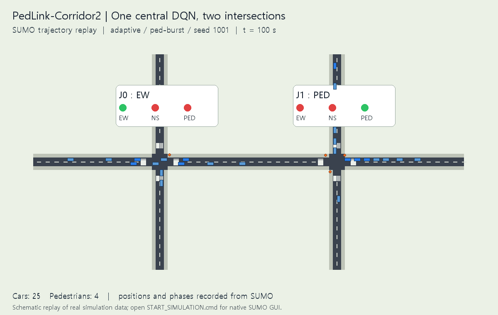

# PedLink-Corridor2: 단일 중앙 DQN으로 제어하는 가상 연속 사거리 2개

2026-11-12 팀 논의 반영. **실제 세종대 앞 도로를 재현하지 않고, 가상의 연속 사거리 2개를 하나의 DQN이 함께 제어한다.** 기존 보행자 우선·대기 연동 전환 비용 아이디어를 이 환경에 옮겼다.

교차로가 2개라는 것은 환경에 신호 제어 지점이 2개라는 뜻이다. 에이전트 수가 2개라는 뜻은 아니다. 이 구현은 **관측 벡터 하나 → DQN 하나 → 공동 행동 하나**이며, 사거리별 독립 모델이나 멀티에이전트 학습은 사용하지 않는다.

## 팀 합의를 어떻게 반영했는가?

| 항목 | 반영 내용 |
|---|---|
| 실험 장소 | 직접 생성한 합성 도로, 실제 세종대 도로·관측 수요 사용 안 함 |
| 도로 형태 | 동서 간선으로 연결된 사거리 J0·J1, 중심 간격 140m |
| 규모 | 동서 전체 340m, 각 남북 도로 170m, 차량 방향별 1차로 |
| 교통 | 동서 차량은 두 사거리를 연속 통과, 각 사거리 남북 차량도 직진 통행 |
| 보행자 | 사거리당 네 횡단보도, 총 8개. 차량과 분리된 전용 보행 현시 |
| 제어기 | 단일 중앙 vanilla DQN, CPU 실행 |
| 추가 아이디어 | 30초 보행 우선 마스크, 보행 대기 연동 신호 전환 비용 |

```text
         북0                  북1
          │                    │
서 ───── J0 ──────────────── J1 ───── 동
          │                    │
         남0                  남1
             ↑ 두 곳을 한 DQN이 공동 제어 ↑
```

차량 회전은 제외하고 직진만 구현했다. 보행자는 특정 접근로 양쪽 보도 사이의 횡단보도 한 곳을 건넌다. 출발점은 교차로 인근 보도에 두어 불필요한 긴 접근 보행을 줄였다. 실제 경로가 crossing을 통과했는지도 결과에서 검증한다. 실제 도로 재현이나 실측 보정은 이번 범위가 아니다.

## 이전 실험과의 관계

| 실험 | 공간·대상 | 단일 DQN 입력 / 공동 행동 | 역할 |
|---|---|---|---|
| 기존 Corridor2-DQN | 사거리 2개, 차량만 | 29 / 4 | 차량 대기 최소화 기본 기준선 |
| 이전 PedLink-DQN | 직선 도로의 횡단보도 4곳, 차량·보행자 | 62 / 16 | 우선 규칙·전환 비용 탐색 단계 |
| **현재 PedLink-Corridor2** | **사거리 2개와 횡단보도 8개, 차량·보행자** | **52 / 9** | **팀 합의를 반영한 현재 연구 환경** |

도로·행동·보상·학습 길이가 다르므로 서로의 평균 대기 수치를 그대로 비교해 알고리즘 우열로 해석하지 않는다. 이전 모델은 이번 환경과 호환되지 않아 **세 변형 모두 새로 학습했다.**

## 논문에서 가져온 것과 바꾼 것

직접적인 문제의식은 Poudel 외의 **Joint Pedestrian and Vehicle Traffic Optimization in Urban Environments using Reinforcement Learning**, IROS 2025, [arXiv:2504.05018v2](https://arxiv.org/abs/2504.05018v2)에서 가져왔다. 원 연구는 실제 Craver Road의 교차로·횡단보도 제어 노드 8곳을 하나의 PPO 정책으로 제어해 차량·보행자의 효율을 함께 다룬다.

우리는 이를 바탕으로 PPO 대신 DQN을 구현하고, 작은 합성 도로로 옮겼으며, 보상도 누적 정지 시간의 가중합으로 바꿨다. 현재 팀 결정에 따라 사거리 2개로 구성했다. 원 논문의 도로·수요·보상을 그대로 둔 PPO↔DQN 대조 실험은 아니다. 원 논문 개선율을 우리 결과로 사용하지 않는다. 기존 국내 차량·보행자 중앙 제어 논문 역시 ‘여러 교차로를 에이전트 하나가 제어할 수 있다’는 배경이다.

## 상태·행동·보상

### 하나의 상태 입력: 52개 숫자

`전역 시간 1 + 사거리별 25×2 + 네트워크 미진입 차량 수 1 = 52`

사거리별 25개는 유입 4차로의 전체 차량 수 4개·정지 차량 수 4개, 접근로별 보행 대기열 4개, 최장 보행 대기 1개·최장 차량 대기 1개·횡단 점유 1개·단계 경과 시간 1개, 단계 one-hot 6개, 전환 목표 one-hot 3개다. 항목별 정규화 후 [0,2]로 제한한다. 신호 전환 중 다음 목표도 관측에 포함한다.

### 하나의 공동 행동: 9개

각 사거리의 요청은 `0=동서 차량(EW)`, `1=남북 차량(NS)`, `2=전용 보행(PED)`이다. 전체 행동은 `[J0 요청, J1 요청]`의 조합이므로 `3²=9`개다. 예를 들어 행동 ID 5는 `[1,2]`, 즉 J0 남북 차량·J1 보행 요청이다.

신경망은 **52 → 128 ReLU → 128 ReLU → 9**다. 출력 9개가 공동 행동별 Q값이다. 저장 모델의 `obs_size=52`, `actions=9`, 메타데이터의 `agent_count=1`, `junction_count=2`와 연결해 확인할 수 있다.

### 보상과 두 아이디어

5초 구간마다 `r_base = -(정지 차량·초 + 미진입 차량·초 + 2×정지 보행자·초)/100`을 계산한다.

| 변형 | 적용 내용 |
|---|---|
| `basic` | 기본 보상 + 모든 방법에 공통인 최소·최대 시간과 신호 전환 제약 |
| `priority` | 기본형 + 차량 현시 최소 시간 충족 후 사거리 내 최장 보행 대기 ≥30초이면 PED 요청만 허용 |
| `adaptive` | 우선형 + 아래 대기 연동 전환 비용 |

`c_j = 0.02 × I(서비스 요청 전환) × max(0, 1-w_j/30)`

`r_adaptive = r_base - (c_J0+c_J1)/2`

`w_j`는 해당 사거리에서 가장 오래 연속 대기 중인 보행자의 시간이다. 네 횡단보도를 한 보행 현시로 서비스하므로 사거리 안의 최장 대기를 사용한다. 차량↔보행뿐 아니라 EW↔NS 서비스 전환에도 비용이 적용된다. 황색·전적색 같은 중간 단계마다 중복 부과하지 않는다. 각 사거리 비용은 최대 0.02, 한 곳만 최대 비용으로 전환하면 전역 비용은 0.01이다.

임계값 30초·가중치 2·비용 0.02는 시험 설계값이며 최적값으로 검증하지 않았다. 규칙과 비용은 사람이 정의하고 DQN은 그 안에서 선택을 학습한다. 이를 AI가 스스로 발견한 새로운 규칙이라고 설명하지 않는다.

## 신호 제약과 강화학습 방식

- 차량 녹색 최소 15초, 보행 녹색 최소 10초.
- 차량 현시가 60초 이상이면 보행 대기 또는 반대 차량 대기를 보고 경쟁 서비스 요청을 강제한다. 우선형은 보행 최장 대기 30초부터 보행 요청을 강제한다.
- 보행 현시가 30초 이상이고 차량이 기다리면 차량 요청만 허용한다.
- 차량 현시 전환은 황색 4초 → 전적색 2초 → 요청 서비스 순서다.
- 보행에서 차량으로 전환할 때는 최소 10초 정리 시간을 두고, 횡단 중 사람이 없을 때만 차량 녹색으로 돌아간다.
- 의사결정 간격 5초와 전환 시간이 있으므로 30초 이내 실제 횡단 시작을 보장한다는 뜻은 아니다.

마스크는 무작위 탐험, 최대 Q값 선택, 다음 상태 TD 타깃 모두에 적용한다. DQN은 경험 재생 50,000개, 배치 64, Adam 학습률 0.001, γ=0.99, Huber loss, gradient clipping 10, 250회 업데이트마다 타깃 동기화를 사용한다. 128개 경험부터 두 결정마다 학습한다. Double/Dueling DQN이나 독립 에이전트는 사용하지 않았다.

## 실제 학습·평가

조건별 **30에피소드**, 한 에피소드 **300초 수요 발생 + 300초 배출 = 600초**, 모델별 **3,600회 공동 의사결정·1,737회 경사 업데이트**를 실행했다. 독립 학습 초기화는 변형별 한 번(seed 42)이다.

학습 수요 시드는 42+1000×에피소드 인덱스이며 세 수요 유형을 번갈아 사용한다. 평가 수요 시드 1001~1003과 겹치지 않는다. 같은 시드·수요 유형에서 모든 방법의 명시적 차량·보행 수요 파일 해시가 일치한다.

| 수요 | 동서 방향별 차량 | 사거리별 남북 방향별 차량 | 각 횡단보도 보행 수요 |
|---|---:|---:|---:|
| balanced | 360대/시간 | 120대/시간 | 30명/시간 |
| vehicle-heavy | 540대/시간 | 180대/시간 | 15명/시간 |
| ped-burst | 360대/시간 | 120대/시간 | 15명/시간 + 집중 유입 |

집중 유입은 J0 북측에 120초부터 18명, J1 남측에 150초부터 18명을 0.5초 간격으로 추가한다. 시간당 수요는 생성률이며 실제 발생 인원은 시드에 따라 달라진다.

학습 모델 3개에 고정 신호와 단순 대기열 규칙을 더해 `5개 방법 × 3개 수요 × 3개 시드 = 45회` 평가했다. 고정 신호는 EW 25초·NS 25초·PED 15초와 공통 전환 제약을 사용한다. 대기열 규칙은 동서·남북 정지 차량 수와 `2×보행 대기 인원+최장 보행 대기/10` 점수를 비교한다. 이 단순 규칙을 현장의 모든 감응식 제어를 대표한다고 보지 않는다.

## 평가 결과

아래는 수요 시드 3개 지표의 산술평균이다. P95 역시 시드별 P95를 평균한 값이다. 보행 P95는 긴 대기 쪽의 분포를 보는 지표이며 평균 대기와 구분한다. 전환 수는 두 사거리의 서비스 변경 합계다.

| 수요 | 방법 | 차량 평균 대기(초) | 보행 평균 대기(초) | 보행 P95(초) | 전환 수 |
|---|---|---:|---:|---:|---:|
| balanced | fixed | 44.11 | 30.81 | 65.77 | 38.00 |
| balanced | queue | 27.99 | 21.44 | 46.07 | 29.67 |
| balanced | basic | 30.18 | 42.98 | 116.97 | 22.33 |
| balanced | priority | 29.72 | 25.73 | 51.77 | 26.00 |
| balanced | adaptive | 24.93 | 28.68 | 54.02 | 27.00 |
| vehicle-heavy | fixed | 58.94 | 31.34 | 65.92 | 38.00 |
| vehicle-heavy | queue | 24.84 | 26.89 | 59.20 | 29.67 |
| vehicle-heavy | basic | 28.49 | 57.73 | 118.98 | 23.67 |
| vehicle-heavy | priority | 25.21 | 33.44 | 50.87 | 23.67 |
| vehicle-heavy | adaptive | 22.16 | 36.90 | 53.27 | 25.00 |
| ped-burst | fixed | 44.66 | 13.61 | 41.52 | 38.00 |
| ped-burst | queue | 22.21 | 10.51 | 27.33 | 26.67 |
| ped-burst | basic | 27.93 | 17.50 | 56.67 | 23.33 |
| ped-burst | priority | 28.64 | 14.37 | 46.42 | 22.00 |
| ped-burst | adaptive | 22.41 | 17.85 | 41.12 | 27.00 |

결과 해석:

- 보행자 우선형은 이번 세 수요 모두에서 기본형보다 보행 평균·P95가 낮았다. 특히 balanced·vehicle-heavy에서 기본형의 긴 보행 대기가 크게 줄었다.
- 대기 연동 비용형은 이번 세 수요 모두 우선형보다 차량 평균 대기가 낮았지만, 보행 평균 대기는 높았다. 우선형 대비 신호 전환도 줄지 않았다.
- 간단한 대기열 규칙이 보행 지표에서 학습 모델보다 좋은 조건도 있다. 특히 ped-burst에서는 규칙의 보행 평균·P95가 좋았다. 현재 DQN 또는 추가 아이디어가 규칙보다 일반적으로 우수하다고 주장할 수 없다.
- 45회 모두 차량·보행자 전원 도착, 미진입·잔여 0, 충돌·teleport 0이었다. teleport는 비활성화했다.
- 수요 일치, 인원 회계, 보행자의 실제 crossing 통과, **54,000개 신호 노드·초의 단계 제약과 횡단 정리**를 검증했다. 별도의 SUMO GUI 실행 결과·행동 기록도 headless 평가와 일치했다.

한 번의 독립 초기화, 작은 합성 수요, 직진 교통만 다룬 탐색 실험이다. 초기화 반복·추가 시드·계수 탐색·동일 환경 PPO 비교가 후속 과제다. 가상 사거리 2개로 바꾼 사실이 현실 도로 성능을 입증하지는 않는다.

## 시뮬레이션과 실행



위 영상은 실제 SUMO의 차량·보행자 위치와 실제 신호 기록을 100~240초 구간에서 2초 간격으로 읽어 재생한 **도식 영상**이다. SUMO GUI를 캡처한 영상은 아니다. 이 PC에서 native GUI의 스냅샷 기능이 멈춰, 기본 시뮬레이션과 영상 생성을 분리했다. 기본 GUI 실행은 캡처 없이 600초를 정상 완료했고 headless와 결과·행동이 일치했다.

이미 준비된 환경에서는 이 폴더의 **`START_SIMULATION.cmd`를 더블클릭**하면 두 사거리와 실제 신호·차량·보행자를 SUMO GUI로 볼 수 있다. **`TRAIN_AND_COMPARE.cmd`**는 세 모델을 새로 30회씩 학습하고 5개 방법을 평가한 뒤 GUI를 연다. GUI 재생 자체는 저장된 모델의 추론이며 학습을 계속하는 기능은 아니다.

새 PC에서는 Python 3.10 이상, SUMO 1.28을 사용한다. GUI는 전체 SUMO 설치와 올바른 `SUMO_HOME` 설정이 필요하다. 아래 명령은 이 실험 폴더에서 실행한다.

```powershell
python -m venv .venv
.\.venv\Scripts\python.exe -m pip install -r requirements.txt
$env:SUMO_HOME = 'C:\Program Files (x86)\Eclipse\Sumo' # 실제 설치 경로
.\START_SIMULATION.cmd

# 학습한 모델 재평가: 새 출력 폴더
powershell -ExecutionPolicy Bypass -File .\RUN_HERE.ps1 -Mode Evaluate -Variant adaptive
# 새 학습·평가 전체
powershell -ExecutionPolicy Bypass -File .\RUN_HERE.ps1 -Mode All -Episodes 30
# 상태 기계 경계 테스트와 포함 결과 검증
.\.venv\Scripts\python.exe test_signals.py
.\.venv\Scripts\python.exe verify_results.py
```

Linux 서버에서는 `python3 -m venv .venv`, `source .venv/bin/activate`, `python -m pip install -r requirements.txt`로 설치한 뒤 `python run.py train --variant adaptive --episodes 30 --out results/new-adaptive-1`처럼 실행한다. 화면 없는 서버에서는 `train`, `evaluate`, `baselines`, `record`를 사용한다. GUI에는 디스플레이가 필요하다. 현재 구현은 CPU 기준이므로 RTX 5080이 있어도 자동 CUDA 학습으로 바뀌지 않는다.

저장 체크포인트는 추론 가중치·환경 스키마·메타데이터다. optimizer와 replay까지 포함한 중단 재개 파일은 아니다. 네트워크를 새로 `build`해서 해시가 바뀌면 새 모델이 필요할 수 있다. 포함된 네트워크와 모델은 짝을 유지한다.

## 읽을 파일

- `run.py`: 사거리·보도·횡단보도 생성, 합성 수요, 관측, 공동 행동, 3서비스 상태 기계, 규칙 기준선과 GUI.
- `core.py`: 공통 학습·평가, 누적 대기 집계. `traffic_rl/dqn.py`: 기존과 같은 DQN을 재사용한 스냅샷.
- [학습 메타데이터](results/train-adaptive/summary.json), [평가 요약 CSV](results/comparison.csv), [검증 기록](results/verification.json).
- `results/eval-*/`와 `results/baselines/`: 수요·결정·1초 신호 기록. `results/gui-demo/`: 캡처 없이 실행한 실제 GUI 결과.
- `results/replay/`: SUMO 위치 기록과 원본 신호. `python run.py record --out results/replay-new-1`로 새 기록을 만들 수 있다. 포함 영상 재생성은 `python render_replay.py`다.
- 도로·보행 구현은 [SUMO 보행자 문서](https://sumo.dlr.de/docs/Simulation/Pedestrians.html)와 [PlainXML 문서](https://sumo.dlr.de/docs/Networks/PlainXML.html)를 따른다.

GitHub의 현재 실험 브랜치는 **`experiment/pedlink-corridor2-dqn`**이다. `experiment/corridor2-dqn`은 차량 전용 기준선, `experiment/pedlink-dqn`은 이전 네 횡단보도 단계로 보존한다.
