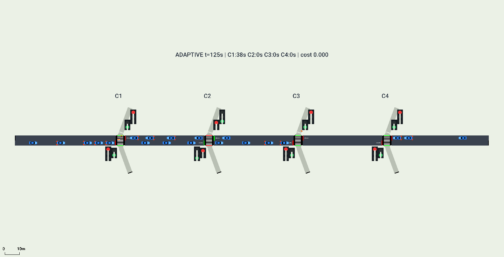

# PedLink-DQN: 네 횡단보도의 차량·보행자 대기 절충

320m 왕복 도로의 네 횡단보도를 한 중앙 DQN으로 제어한다. PPO 기반 차량·보행자 공동 최적화 논문의 문제의식을 작은 합성 도로로 옮겨, 보행자 우선 마스크와 대기 연동 전환 비용을 비교했다.

**[팀 프로젝트 상세 설명·기존 두 사거리 실험과 비교](../../docs/EXPERIMENT_COMPARISON_KO.md)** · [논문 원문·출처](../../papers/README.md)



## 무엇이 들어 있는가?

| 파일 | 역할 |
|---|---|
| `run.py` | 4개 횡단보도, 수요, 62차원 관측과 공동 행동 16개 |
| `core.py` | 신호 단계·보행 우선·전환 비용, 학습/평가, 대기 집계 |
| `../../src/traffic_rl/dqn.py` | 공유 DQN, replay, target network와 마스킹 |
| `network/` | 합성 도로 생성 입력 XML과 SUMO 1.28 생성 네트워크 |
| `results/train-{basic,priority,adaptive}/` | 조건별 30회 학습 모델·메타데이터·에피소드 지표 |
| `results/eval-*/` | 동일 수요 평가 27회의 결과·1초 신호 및 5초 결정 기록 |
| `verify_results.py` | 포함된 결과·모델 해시·수요 회계·신호 제약 검사 |

세 조건은 공통 신호 제약이 같으며 `basic`은 기본 보상, `priority`는 30초 보행 우선 마스크 추가, `adaptive`는 우선 규칙에 대기 연동 전환 비용을 추가한다. 비용은 구현됐지만 현재 평가에서 전환 수를 줄였다는 결론은 나오지 않았다. 한 조건당 독립 학습 1회인 탐색 실험이다. 평가 종료 시 총 13대의 잔여 차량이 있어 이후 대기는 절단된다.

## 설치와 실행

저장소 최상위의 `.venv`와 `requirements.txt`를 사용한다. Python 3.10 이상, SUMO 1.28 기준이다. GUI에는 전체 SUMO 설치와 `SUMO_HOME` 설정이 필요하다. 현재 네트워크 파일을 그대로 사용하면 포함된 모델과 스키마가 일치한다. `build`로 다시 생성한 네트워크의 해시가 달라지면 새 모델을 학습해야 한다.

```powershell
# 저장소 최상위에서
python -m venv .venv
.\.venv\Scripts\python.exe -m pip install -r requirements.txt
$env:SUMO_HOME = 'C:\Program Files (x86)\Eclipse\Sumo' # 실제 설치 경로
.\experiments\pedlink-dqn\START_SIMULATION.cmd

# 새 평가와 세 변형 새 학습·평가
powershell -ExecutionPolicy Bypass -File .\experiments\pedlink-dqn\RUN_HERE.ps1 -Mode Evaluate -Variant adaptive
powershell -ExecutionPolicy Bypass -File .\experiments\pedlink-dqn\RUN_HERE.ps1 -Mode All -Episodes 30

# 기록 검증
.\.venv\Scripts\python.exe experiments/pedlink-dqn/verify_results.py
```

학습 실행과 GUI 추론은 별도다. 현재 코드는 CPU를 사용한다. RTX 5080이 있어도 자동 CUDA 학습이 되지 않는다. 해당 PC의 PyTorch/CUDA 설치는 별도로 확인해야 하며 원 작업 PC의 runtime·SUMO 실행파일은 저장소에 포함하지 않았다.

Linux에서는 같은 저장소에서 `python3 -m venv .venv`, `source .venv/bin/activate`, `python -m pip install -r requirements.txt`로 설치한다. 서버에 SUMO 1.28의 실행파일과 TraCI가 있어야 한다. 화면 없는 학습·평가는 아래처럼 실행하며 GUI 시연은 디스플레이가 있는 환경에서 실행한다.

```bash
python experiments/pedlink-dqn/run.py train --variant adaptive --episodes 30 --out results/local/pedlink-train-1
python experiments/pedlink-dqn/run.py evaluate --model results/local/pedlink-train-1/model.pt --out results/local/pedlink-eval-1
```

배포 검증 기록은 [publication-verification.json](results/publication-verification.json)에 있다. 폴더를 분리한 배포 코드로 adaptive의 9회 평가를 재실행해 기존 결과·5초 결정·1초 신호 기록과 전부 일치했고, 2회 시험 학습에서 21회 업데이트를 확인했다. 공통 코드 테스트 18개도 통과했다. 추가 시험 학습은 논문 성능 평가의 반복 학습으로 세지 않는다.

체크포인트는 추론 가중치와 환경 스키마·메타데이터다. optimizer·replay를 포함한 중단 재개 파일은 아니다. 새 학습은 새로운 결과 폴더를 만든다. 보존 모델은 덮어쓰지 않는다.

논문: Poudel 외, *Joint Pedestrian and Vehicle Traffic Optimization in Urban Environments using Reinforcement Learning*, IROS 2025, [arXiv v2](https://arxiv.org/abs/2504.05018v2). 현재 결과는 원 논문 재현 또는 공정한 PPO 대비 성능 비교로 제시하지 않는다.
